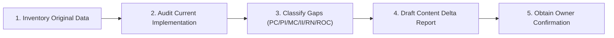

# Inchara Holidays — Original Content Reconciliation

This skill provides a rigorous method for tracking, preserving, and reconciling business content across all project sources to ensure zero information loss during modern UI redesign.

## When to Use This Skill
- Auditing the website for missing sections, packages, itineraries, or services.
- Reconciling Figma UI designs with the original website's content data.
- Reviewing packages and itineraries in `src/data/packagesData.ts`.
- Validating business claims, contact details, partner affiliations, and legal disclaimers.
- Planning content recovery milestones before modifying UI components.

---

## 1. The Three Source Repositories

When performing content reconciliation, compare these three specific sources:

| Source | Role | Authoritative For | Location / Artifact |
|---|---|---|---|
| **Original Website** | Business Ground Truth | Full itineraries, inclusions/exclusions, vehicle types, service catalog, phone numbers, addresses | Legacy code in repo, `packagesData.ts`, `docs/archive/` |
| **Figma UI Export** | Visual Reference | Visual hierarchy, typographic scale, color tokens, layout rhythm, card styling | `new_ui_design/`, Figma artboards |
| **Current Implementation** | Live Application | Component code, current routing, active state, browser rendering | `src/`, `public/assets/` |

---

## 2. Six-Status Content Classification Matrix

Every inspected content item must be classified into one of these six standard states:

1. **Preserved Correctly (PC)**: Completely present, accurate, styled appropriately, and functional in both English and Kannada.
2. **Preserved But Incomplete (PI)**: Present in the UI, but missing essential details (e.g., package title is present, but day-by-day itinerary or vehicle capacity was omitted).
3. **Missing Completely (MC)**: Present on the original website, but entirely absent in the current build.
4. **Implemented Incorrectly (II)**: Present, but functionally or visually broken (e.g., misaligned button, broken modal anchor, wrong translation).
5. **Replaced By New Functionality (RN)**: Deliberately upgraded with an improved modern component (e.g., legacy static contact form replaced by 4-step Universal Enquiry Dialog).
6. **Requires Owner Confirmation (ROC)**: Business claim, statistic, or unverified asset that requires explicit owner validation before publishing.

---

## 3. Reconciliation Checklist by Domain

### A. Core Services Inventory
- [ ] **Holiday Packages**: All primary routes (Karnataka Heritage, Coorg/Wayanad, Golden Triangle, Kerala Backwaters, Himachal, International) represented with complete days, nights, and key stops.
- [ ] **Educational Tours**: Curriculum-aligned field visits, industrial immersion categories, student safety provisions, and teacher-chaperone benefits clearly documented.
- [ ] **Corporate Tours**: MICE offerings, team-building retreats, corporate transport logistics, conference facility coordination documented.
- [ ] **Transport & Fleets**: Vehicle roster clearly listed with passenger capacities (Sedan 4, SUV 7, Tempo 12–17, Mini Bus 21–25, Large Coach 35–50), AC/Non-AC options, luggage limits.
- [ ] **Visa & Passport**: Accurate list of assisted visa categories (Tourist, Student, Business), documentation requirements, appointment scheduling assistance.
- [ ] **Pure Veg Catering**: Mysore & South Indian traditional plantain leaf feasts, satvik food provisions, tour group catering logistics, hygiene standards.

### B. Business & Contact Data
- [ ] **Official Office Address**: Kuvempunagar / Mysore headquarters clearly stated without invented branches.
- [ ] **Phone & WhatsApp**: Official contact number (`+91 94482 17345`) active in footer and WhatsApp routing.
- [ ] **Operating Hours**: Accurate hours of operation clearly published.
- [ ] **Affiliations & Accreditations**: Verified travel trade affiliations (KTF Karnataka, IATTE India, ABTO Tourism, UTEN Fraternity) with accurate logos.

### C. Bilingual Kannada & English Sync
- [ ] Every headline, description, service card, button label, and form input has accurate Kannada text.
- [ ] No raw English strings leak through when Kannada (`ಕ`) mode is active.
- [ ] Kannada font rendering uses `Noto Serif Kannada` and `Noto Sans Kannada` without overlapping glyphs or clipped vowel signs.

---

## 4. Reconciliation Workflow & Deliverables

When completing a content reconciliation cycle, produce or update a structured audit table in `docs/analysis/UI_RECOVERY_AUDIT.md` or the corresponding milestone report.

### Golden Rules
- **Never delete or truncate original itinerary details** for the sake of minimalistic design. Use tabs or modals to house extensive text.
- **Never invent prices or discounts** (e.g., "From ₹9,999") unless verified in original rate cards or confirmed by the business owner.
- **Never claim unverified certifications** or government registrations without official documentation.
