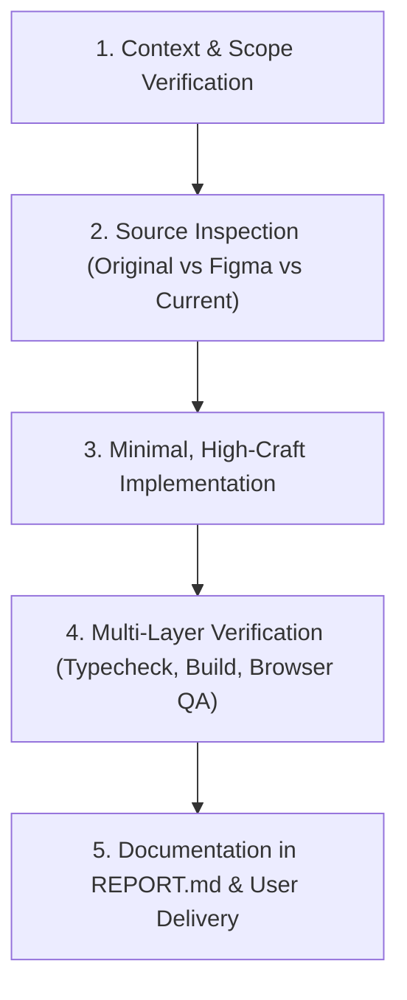

# Inchara Holidays — Project Guardrails & Engineering Governance

This skill defines the non-negotiable operational boundaries, milestone governance, change control procedures, and reporting requirements for the Inchara Holidays platform.

## When to Use This Skill
- **Always Active**: Must be referenced and applied at the start, execution, and conclusion of every task in the Inchara Holidays repository.
- When planning new features, refactoring existing code, or auditing milestones.
- Whenever a proposed change touches business content, service offerings, or branding.

---

## 1. Core Operating Principles

### A. Five-Tier Source of Truth Precedence
Always resolve discrepancies according to this hierarchy:
1. **Approved Project Requirements & Owner Decisions**: Highest priority.
2. **Original Website Implementation**: Authoritative baseline for existing itineraries, service offerings, vehicle specs, and business descriptions.
3. **Figma Design References**: Authoritative for layout rhythm, art direction, and visual tokens.
4. **Current Integrated Codebase**: Code under audit; never assume it is complete or correct without testing.
5. **Historical Reports (`REPORT.md`, audit docs)**: Working documentation that must be re-verified against live code.

### B. Change Control & Destruction Prevention
- **No Uncontrolled Rewrites**: Never rewrite an entire module or replace working components when incremental fixes or refactoring suffice.
- **No Silent Deletions**: Do not delete assets, components, or documentation without explicit user approval.
- **Content Integrity**: Retain all authentic original business content. If content feels long, reorganize it using accordions, tabs, or modals rather than discarding it.
- **Honest Claims**: Never invent statistics (e.g., "50,000+ happy travelers"), artificial awards, unverified affiliations, or fixed prices.

### C. Milestone Gate: Backend Separation
- **Strict Frontend/Backend Boundary**: The project is currently in the frontend recovery and visual refinement phase.
- **Do NOT** create live Supabase databases, execute SQL migrations, install backend dependencies, spin up Express API servers, or configure authentication guards until the user provides explicit written authorization.

---

## 2. Standard Task Workflow

Every engineering task in this project must follow these 5 phases:

### Phase 1: Context & Scope Verification
- Confirm the task objective and inspect relevant issues or milestone instructions.
- Ensure the requested action adheres to the current milestone boundaries.

### Phase 2: Source Inspection
- Compare original website content (e.g., `packagesData.ts`, legacy components, assets) against Figma designs in `new_ui_design/`.
- Ensure no required business details (inclusions, day-by-day itineraries, contact info) are lost.

### Phase 3: Minimal, High-Craft Implementation
- Implement changes using established tokens, semantic HTML, and clean React 19/Tailwind CSS v4 patterns.
- Keep components typed and maintain bilingual English (`EN`) and Kannada (`ಕ`) support.

### Phase 4: Multi-Layer Verification
- Run TypeScript verification: `npx tsc --noEmit` (must exit with code 0).
- Run production build: `npm run build` (must compile cleanly).
- Execute visual & functional tests across target viewports (360×800, 390×844, 768×1024, 1440×900).

### Phase 5: Documentation in REPORT.md
- Append a structured summary section to `REPORT.md` at the project root covering:
  - Task objective and cycle number.
  - Files modified or created.
  - Tests performed and actual outcomes.
  - Verification screenshots and evidence.
  - Clear next steps for the user.

---

## 3. Prohibited Actions & Red Flags

| Red Flag Action | Why It Is Prohibited | Proper Remedy |
|---|---|---|
| Replacing custom components with generic UI libraries | Degrades custom heritage-modern art direction | Enhance existing Tailwind v4 components |
| Deleting original service content | Causes loss of critical travel business data | Reorganize into structured cards or modals |
| Adding floating buttons (WhatsApp/Call) | Clutters viewport and covers hero navigation | Use footer directory and enquiry completion modal |
| Claiming live payment/booking capability | Deceives customers; business operates via consultation | Provide consultation inquiry routing |
| Jumping to Supabase/Express backend setup | Violates project sequencing and milestone gates | Keep inquiries persistent via local cache + WhatsApp |

---

## 4. Acceptance Criteria for Every Task

1. `npx tsc --noEmit` exits with 0 errors.
2. `npm run build` generates production bundle without warnings or errors.
3. Bilingual support (EN/KN) works without layout breakage or missing strings.
4. No console errors or runtime warnings in browser DevTools.
5. `REPORT.md` is updated with full transparency and verified evidence.
