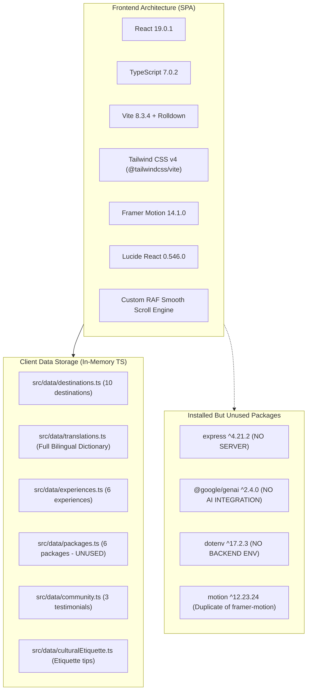
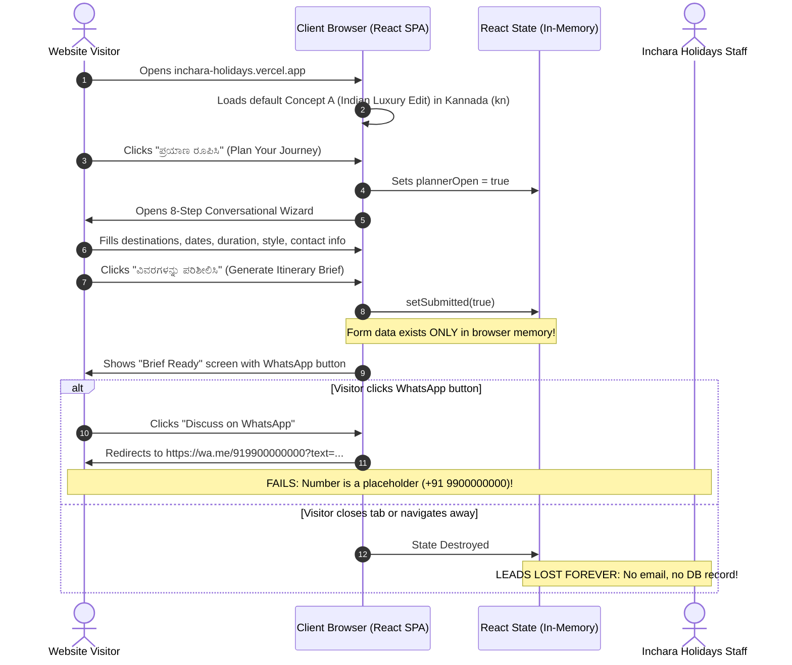
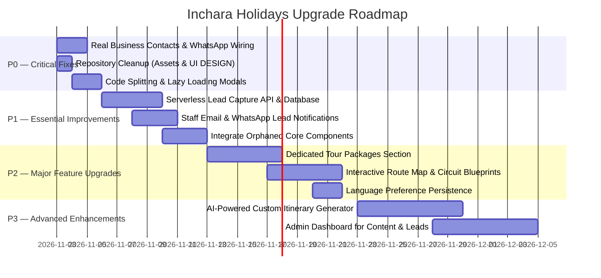

# INCHARA HOLIDAYS — MASTER PROJECT UNDERSTANDING & TECHNICAL AUDIT
**Document Version**: 1.0.0  
**Audit Date**: November 2, 2026  
**Auditor Roles**: Senior Software Architect · Full-Stack Lead · Frontend/Backend Engineer · UI/UX Designer · Technical Project Manager  
**Repository**: `https://github.com/Srinidhi-070/Inchara-Holidays.git` (Branch: `main`)  
**Deployment Target**: Vercel (`https://inchara-holidays.vercel.app`)

---

## 1. Executive Summary

**Inchara Holidays (ಇಂಚರ ಹಾಲಿಡೇಸ್)** is an experiential travel and South Indian hospitality web platform celebrating Karnataka heritage, Western Ghats nature circuits, 100% pure vegetarian catering, corporate retreats, and educational expeditions.

### Core Architectural Status
1. **Frontend Architecture**: The application is currently a **pure Single Page Application (SPA)** built with **React 19.0.1**, **TypeScript 7.0.2**, **Vite 8.3.4 (with Rolldown engine)**, **Tailwind CSS v4 (`@tailwindcss/vite` 4.3.3)**, and **Framer Motion 14.1.0**.
2. **Backend & Database Status**: **0% Implemented (Pure Client-Side Simulation)**. While `express`, `dotenv`, `@google/genai`, and `tsx` are installed in `package.json`, **no server exists**, no API routes exist, no database is connected, and no AI services are initialized. All inquiries simply update React component state in memory and surface placeholder WhatsApp links (`+91 9448000000`, `+91 9900000000`).
3. **Design System & Culture**: Outstanding visual execution rooted in traditional Karnataka culture, Hoysala stone architecture, Mysore royal iconography, and authentic Kannada typography (`Noto Sans Kannada`, `Noto Serif Kannada`).
4. **Current Stability**: The project builds cleanly with **0 TypeScript errors** and runs with **0 browser console errors/exceptions**. However, it suffers from code bundling bloat (598 kB single JS chunk), ~45MB of orphaned/duplicate assets (`UI DESIGN/` folder, duplicate `src/assets/images/`), 4 fully developed components that are disconnected from the DOM (`ExperiencesSection`, `WhyUs`, `HowItWorks`, `CtaInvitation`), and unrendered data packages (`src/data/packages.ts`).

---

## 2. Technology Stack & Dependencies Audit



### Detailed Package Inventory

| Package | Version | Classification | Real Status in Source Code |
| :--- | :--- | :--- | :--- |
| `react` | `^19.0.1` | Core Framework | **Active**. Powers the entire UI component tree. |
| `react-dom` | `^19.0.1` | Core Framework | **Active**. Client-side DOM mounting in `src/main.tsx`. |
| `vite` | `^8.3.0` | Build System | **Active** (resolves to Vite v8.3.4 with Rolldown). Builds production bundles in 746ms. |
| `@tailwindcss/vite` | `^4.3.3` | Styling | **Active**. Compiles Tailwind v4 theme definitions and utility classes. |
| `tailwindcss` | `^4.3.3` | Styling | **Active**. |
| `framer-motion` | `^14.1.0` | Motion Engine | **Active**. Drives modal entry/exit, stepper transitions, and spring cursor. |
| `motion` | `^12.23.24` | Motion Engine | **Redundant**. Duplicate installation of Motion One/Framer Motion. Should be cleaned. |
| `lucide-react` | `^0.546.0` | Iconography | **Active**. UI icons paired with custom SVGs in `SouthIndianMotifs.tsx`. |
| `express` | `^4.21.2` | Backend Framework | **Orphaned (0% Used)**. Not imported anywhere in `src/`. No server script exists. |
| `@google/genai` | `^2.4.0` | AI Integration | **Orphaned (0% Used)**. Not imported anywhere. App has no AI functionality currently. |
| `dotenv` | `^17.2.3` | Environment Config | **Orphaned (0% Used)**. Client Vite uses `import.meta.env`. |
| `tsx` | `^4.21.0` | Node Execution | **Orphaned (0% Used)**. Intended for running server scripts that do not exist. |
| `typescript` | `^7.0.2` | Compiler | **Active**. Strict type verification (`npm run lint` passes with 0 errors). |

---

## 3. Project Directory Structure & File Inventory

```
new website design/
├── .env.example                     # Google AI Studio / Cloud Run placeholder env vars (UNUSED)
├── .gitignore                       # Git exclusions (node_modules, dist, .env)
├── .npmrc                           # legacy-peer-deps=true configuration
├── index.html                       # HTML5 entry with 6 Google WebFont links
├── metadata.json                    # Google AI Studio metadata (indicates planned Server-Side Gemini API)
├── package.json                     # Root project configuration and scripts
├── package-lock.json                # Locked dependency tree
├── PROJECT_DOCUMENTATION.md         # Previous project summary documentation
├── README.md                        # Project introductory notes
├── tsconfig.json                    # TypeScript compiler options (bundler mode)
├── vercel.json                      # Vercel SPA routing rewrite configuration
├── vite.config.ts                   # Vite configuration with React and Tailwind v4 plugins
├── INCHARA_HOLIDAYS_TECHNICAL_AUDIT_AND_UPGRADE_ROADMAP.md # This Comprehensive Master Audit
│
├── public/                          # Static public asset directory
│   ├── favicon.svg                  # Brand Ambari Elephant SVG favicon
│   └── images/                      # 17 Web-optimized regional travel & food images (~14.5MB)
│
├── src/                             # Application source code
│   ├── main.tsx                     # React 19 root bootstrap
│   ├── App.tsx                      # Top-level state orchestrator and modal controller
│   ├── index.css                    # 2,291 lines of Tailwind v4 theme, Kolam SVGs, custom CSS
│   │
│   ├── assets/                      # [DUPLICATE] 17 identical images (~14.5MB) - UNREFERENCED!
│   │   └── images/
│   │
│   ├── types/
│   │   └── index.ts                 # TypeScript data contracts, interfaces, and union types
│   │
│   ├── utils/
│   │   └── smoothScroll.ts          # Custom requestAnimationFrame quartic smooth scroll engine
│   │
│   ├── data/                        # Static local datasets
│   │   ├── translations.ts          # Bilingual dictionary (kn: Kannada, en: English)
│   │   ├── destinations.ts          # 10 detailed regional destinations
│   │   ├── experiences.ts           # 6 signature experiential offerings
│   │   ├── packages.ts              # [ORPHANED] 6 curated tour itineraries (NEVER RENDERED)
│   │   ├── community.ts             # 3 verified traveller reflections
│   │   └── culturalEtiquette.ts     # South Indian temple dress codes and local customs
│   │
│   └── components/                  # 24 UI Components
│       ├── Header.tsx               # Top fixed header with language toggle & mobile menu
│       ├── Hero.tsx                 # Dynamic hero supporting 3 concept directions
│       ├── ConceptSwitcher.tsx      # Bottom dock for switching between concepts A, B, and C
│       ├── DestinationDiscovery.tsx # 5-tile editorial grid (desktop) / 10s auto-carousel (mobile)
│       ├── DestinationModal.tsx     # Deep itinerary modal with phrasebook and etiquette
│       ├── ServicesDiscoverySection.tsx # 4-pillar showcase (Holidays, Corporate, Catering, Schools)
│       ├── SignatureJourney.tsx     # 4 curated journeys with interactive hover thumbnails
│       ├── OurStory.tsx             # The Inchara Difference editorial philosophy section
│       ├── PlannerTeaser.tsx        # Step 01 interactive teaser widget
│       ├── TravellerStories.tsx     # Community quote carousel with photography
│       ├── Footer.tsx               # Full-bleed invitation banner & 3-column directory
│       │
│       ├── TripPlannerModal.tsx     # 8-step conversational inquiry modal
│       ├── CorporateEventModal.tsx  # Corporate retreat and offsite consultation modal
│       ├── CateringModal.tsx        # 100% Pure Veg catering inquiry modal
│       ├── SchoolTripModal.tsx      # School/college educational expedition modal
│       ├── ContactModal.tsx         # Direct customer inquiry modal
│       │
│       ├── SouthIndianMotifs.tsx    # Scalable vector SVGs of 8 authentic cultural motifs
│       ├── CustomCursor.tsx         # Spring-physics custom magnetic cursor
│       ├── ScrollProgressBar.tsx    # Viewport top scroll progress bar
│       ├── FloatingActions.tsx      # Bottom-right back-to-top & quick-plan floating button
│       │
│       ├── [ORPHANED] ExperiencesSection.tsx # 471-line master-detail experience explorer (NOT USED)
│       ├── [ORPHANED] WhyUs.tsx              # 85-line 6-reason cultural guarantee grid (NOT USED)
│       ├── [ORPHANED] HowItWorks.tsx         # 172-line 3-step planning process (NOT USED)
│       └── [ORPHANED] CtaInvitation.tsx      # 86-line closing invitation banner (NOT USED)
│
└── UI DESIGN/                       # [UPSTREAM PROTOTYPE] Figma Make export (~30MB) - UNNECESSARY IN PRODUCTION
    ├── .figma/                      # Figma plugin cache files
    ├── package.json                 # Standalone figma-make-app package configuration
    ├── pnpm-lock.yaml               # PNPM lockfile
    ├── tsconfig.json                # Standalone TS configuration
    ├── vite.config.ts               # Standalone Vite config
    └── src/
        ├── App.tsx                  # 835-line monolithic single-file prototype
        ├── index.css                # Monolithic CSS
        └── main.tsx
```

### Identification of Unused, Duplicated, or Outdated Files

1. **`src/assets/images/` (~14.5 MB)**: Contains 17 images that are bit-for-bit identical to `public/images/`. All source code files reference `/images/...` from `public/`. `src/assets/images/` is 100% unused and inflates repository clone size.
2. **`UI DESIGN/` (~30 MB)**: A complete leftover prototype from a Figma export with its own `pnpm-lock.yaml`, `package.json`, and monolithic `App.tsx`. It is completely decoupled from the root application and should be archived or excluded from production.
3. **`src/data/packages.ts`**: Contains comprehensive itinerary data for 6 curated packages with Kannada/English copy, inclusions, and highlights. It is never imported in any component.
4. **4 Orphaned Components**:
   - `src/components/ExperiencesSection.tsx` (471 lines)
   - `src/components/HowItWorks.tsx` (172 lines)
   - `src/components/WhyUs.tsx` (85 lines)
   - `src/components/CtaInvitation.tsx` (86 lines)  
   These components are completely coded, fully translated, and styled, but are not imported into `src/App.tsx`.

---

## 4. Frontend Architecture Audit

### 4.1 Routing & Navigation
- **Routing Engine**: There is **no client-side router** (no `react-router-dom`, `tanstack-router`, or `wouter`).
- **Navigation Model**: Single Page Application (SPA) driven by **URL fragment hashes** and smooth scrolling:
  - `#destinations` → Smooth scroll to `DestinationDiscovery`
  - `#journeys` → Smooth scroll to `SignatureJourney`
  - `#services` / `#service-corporate` → Smooth scroll to Services module (Corporate)
  - `#service-catering` → Smooth scroll to Services module (Catering)
  - `#service-school` → Smooth scroll to Services module (School Trips)
  - `#difference` → Smooth scroll to `OurStory`
  - `#planner` → Smooth scroll to `PlannerTeaser`
  - `#stories` → Smooth scroll to `TravellerStories`
  - `#top` → Smooth scroll to top of page
- **Custom Smooth Scroll Engine (`src/utils/smoothScroll.ts`)**:
  - Employs a custom `requestAnimationFrame` loop with an `easeInOutQuart` deceleration curve ($1 - (1-t)^4$).
  - Calculates dynamic duration between 650ms and 950ms based on pixel distance.
  - Dynamically measures `.header` height and adds 24px desktop / 16px mobile clearance to prevent sticky header collisions.
  - Automatically cancels on user touch, wheel, or keyboard interaction.

### 4.2 State Management Architecture
The entire application relies on **local React component state** lifted to `src/App.tsx`:

```tsx
// Core State in App.tsx:
const [concept, setConcept] = useState<Concept>('A');           // 'A' | 'B' | 'C'
const [language, setLanguage] = useState<Language>('kn');       // 'kn' | 'en'
const [plannerOpen, setPlannerOpen] = useState<boolean>(false);
const [contactOpen, setContactOpen] = useState<boolean>(false);
const [corporateOpen, setCorporateOpen] = useState<boolean>(false);
const [cateringOpen, setCateringOpen] = useState<boolean>(false);
const [schoolOpen, setSchoolOpen] = useState<boolean>(false);
const [selectedDestination, setSelectedDestination] = useState<Destination | null>(null);
const [plannerInitialDest, setPlannerInitialDest] = useState<string>('');
const [plannerInitialExp, setPlannerInitialExp] = useState<string>('');
```

**Assessment**:
- **Props Drilling**: State is passed down through 1–2 component levels. For the current single-page layout, this is manageable and has low overhead.
- **State Persistence**: **Zero persistence**. Reloading the browser resets the language to Kannada (`kn`), closes all active modals, and resets the multi-step planner. No `localStorage`, `sessionStorage`, or URL search parameter synchronization exists.

### 4.3 Bilingual Localization System
- The bilingual system is 100% locally defined in `src/data/translations.ts`.
- No external i18n library (`react-i18next`, etc.) is used; all components receive `language: Language` (`'kn' | 'en'`) and either index `translations[language]` or evaluate `const kn = language === 'kn'`.
- All text strings in both Kannada and English are written natively with high cultural resonance (e.g. "ನಿರಾತಂಕ ಪ್ರಯಾಣ", "ಅತಿಥಿ ದೇವೋ ಭವ", "ಪಂಕ್ತಿ ಸೇವೆ").

### 4.4 Visual Concepts / Art Directions Switcher
`src/components/ConceptSwitcher.tsx` provides a real-time art direction preview dock:
1. **Concept A ("Indian Luxury Edit")**: Deep Western Ghats forest greens, gold hairlines, quiet luxury serif typography.
2. **Concept B ("Living Travel Journal")**: Warm ivory silk background (`#F6F3EA`), Polaroid photo frames, field notes, tactile editorial journal feel.
3. **Concept C ("Global Explorer")**: Bold mustard gold (`#D4AF37`), high-contrast modern typography, international travel focus ("GO FURTHER").

---

## 5. Backend and Database Audit

> [!WARNING]
> **CRITICAL ARCHITECTURAL FINDING: BACKEND & DATABASE ARE 100% UNIMPLEMENTED.**
> There is no API layer, no backend server, no database, no authentication, and no third-party email/SMS webhook integration currently functioning in this repository.

### Detailed Findings

1. **Server Architecture**:
   - In `package.json`, `"express": "^4.21.2"` is listed in dependencies.
   - However, **no Express application or server file exists**. No `server.js`, `server.ts`, `api/`, or `backend/` folder is present.
   - The `"clean"` script in `package.json` specifies `"clean": "rm -rf dist server.js"`, indicating an old or intended standalone server file that is no longer in the repository.

2. **Database & Persistence**:
   - **Database Technology**: None.
   - **Database Schema**: None.
   - All destination itineraries, package details, testimonials, cultural etiquette notes, and translations exist solely as hardcoded static TypeScript arrays in `src/data/*.ts`.

3. **Customer Inquiries & Form Submissions**:
   - Every modal form (`TripPlannerModal`, `CorporateEventModal`, `CateringModal`, `SchoolTripModal`, `ContactModal`) handles submission with:
     ```tsx
     const handleSubmit = (e: React.FormEvent) => {
       e.preventDefault();
       setSubmitted(true);
     };
     ```
   - No `fetch()`, `axios`, or XHR request is dispatched to any endpoint.
   - The user's input (name, phone, dates, guests, requirements) is stored temporarily in local component `useState` and displayed on the subsequent "Thank You" screen.
   - Closing or refreshing the browser **completely wipes out the customer's inquiry**.
   - The generated action is an external WhatsApp link:
     ```tsx
     href={`https://wa.me/919448000000?text=${encodeURIComponent(generateSummaryText())}`}
     ```
   - **Both WhatsApp phone numbers in the codebase (`+91 9448000000` and `+91 9900000000`) are placeholder dummy numbers.**

4. **Authentication & Authorization**:
   - None. There is no user account creation, no customer login, and no staff admin portal.

5. **Environment Configuration**:
   - `.env.example` specifies `GEMINI_API_KEY` and `APP_URL`.
   - No `.env` or `.env.local` exists in the workspace.
   - No API keys are present or referenced in client-side code.

---

## 6. Website Design and UI/UX Audit

### 6.1 Brand Identity & Cultural Philosophy
The website possesses an authentic, deeply resonant cultural voice. It actively rejects generic modern flat travel agency tropes in favor of a **South Indian Heritage Luxury Design System**:

- **Color Tokens**:
  - `Forest Evergreen` (`#263F32` / `#162E22`): Symbolizes Western Ghats canopy and temple stone.
  - `Mysore Royal Gold` (`#D4AF37`): Symbolizes Dasara illumination and royal palatial accents.
  - `Kasavu Light Gold` (`#F5D77F`): Subtle border rings, badges, and kickers.
  - `Kaavi Terracotta` (`#9E3D28`): Traditional sacred threshold clay for cultural guides.
  - `Warm Sand / Rice Flour` (`#FBF8F1`): Clean, glare-free background surface.
  - `Heritage Ivory` (`#F6F3EA`): Soft body background.
- **Cultural Vector Motifs (`src/components/SouthIndianMotifs.tsx`)**:
  - High-fidelity vector SVGs: Mysore Dasara Ambari Elephant, Dravidian Temple Gopuram, Sacred Lotus, Temple Hanging Bell, Banana Leaf, Sikku Kolam Knot Mandala, and Kolam Loop Border Ribbon.

### 6.2 Typography Hierarchy
- **Primary Display Serif**: *Playfair Display* & *Cormorant Garamond* (used for cinematic titles and pull quotes).
- **Kannada Script**: *Noto Sans Kannada* (body/UI) & *Noto Serif Kannada* (editorial headlines).
- **Body & Functional Sans**: *Plus Jakarta Sans* & *Manrope* (readable forms, metadata, and body paragraphs).

### 6.3 Responsive Breakpoint Behavior
1. **Desktop (> 1024px)**:
   - Asymmetrical 5-tile editorial destination grid.
   - Full-bleed hero with coordinate stamp and scroll cue.
   - Dual-column services grid (`.service-duo`).
   - Signature Journeys with floating hover photo previews.
2. **Tablet (768px - 1024px)**:
   - Grid columns collapse to 2 columns.
   - Modal drawer widths adjust to 85vw.
3. **Mobile (< 768px)**:
   - Destination grid transforms into a horizontal scroll-snap card deck with an automated 10-second timer and manual dot/arrow controls.
   - Top navigation collapses into a dedicated slide-out drawer with brand motif watermark.
   - Modals render as full-height bottom sheets (`h-[94dvh]`).
   - Sticky header switches to compact height with fixed backdrop blur.
   - Custom cursor automatically disables on touch screens.

---

## 7. Feature and Functionality Inventory

| Feature / User Flow | Implementation Classification | Frontend Source | Backend Status | Verified Operational Behavior |
| :--- | :--- | :--- | :--- | :--- |
| **Bilingual Language Switcher** | **Fully Implemented** | `Header.tsx`, `Footer.tsx` | N/A (Client) | Seamless instantaneous toggle between `kn` and `en` across entire site. |
| **Concept Art Direction Dock** | **Fully Implemented** | `ConceptSwitcher.tsx` | N/A (Client) | Real-time preview of 3 art directions (A, B, C); minimizable/reopenable. |
| **Top Bar Navigation & Smooth Scroll**| **Fully Implemented** | `Header.tsx`, `smoothScroll.ts` | N/A (Client) | Custom RAF quartic glide with dynamic header clearance and active section indicator. |
| **Destination Discovery Grid** | **Fully Implemented** | `DestinationDiscovery.tsx` | In-Memory TS | 5-tile editorial grid on desktop; 10s auto-scroll carousel on mobile. |
| **Destination Detail Sheet** | **Fully Implemented** | `DestinationModal.tsx` | In-Memory TS | Displays itinerary blueprint, cultural etiquette, and interactive Kannada phrasebook. |
| **Flagship Services Showcase** | **Fully Implemented** | `ServicesDiscoverySection.tsx`| In-Memory TS | 4 modules: Curated Holidays, Corporate, Pure Veg Catering, School Trips. |
| **Signature Journeys Explorer** | **Fully Implemented** | `SignatureJourney.tsx` | In-Memory TS | 4 curated routes with dynamic hover thumbnails; passes route to Trip Planner. |
| **Traveller Stories Carousel** | **Fully Implemented** | `TravellerStories.tsx` | In-Memory TS | Interactive quote slider with photo pairs and author attribution. |
| **Multi-Step Trip Planner** | **UI Only (Mock Submit)** | `TripPlannerModal.tsx` | **Not Connected** | 8-step conversational wizard; generates Markdown summary & dummy WhatsApp link. |
| **Corporate Event Inquiries** | **UI Only (Mock Submit)** | `CorporateEventModal.tsx`| **Not Connected** | Validates attendee tiers & dates; simulates submit to dummy WhatsApp link. |
| **Pure Veg Catering Inquiries** | **UI Only (Mock Submit)** | `CateringModal.tsx` | **Not Connected** | Collects guest counts & dietary needs; simulates submit to dummy WhatsApp link. |
| **School Expeditions Inquiries** | **UI Only (Mock Submit)** | `SchoolTripModal.tsx` | **Not Connected** | Collects safety protocols & grades; simulates submit to dummy WhatsApp link. |
| **Direct Contact Modal** | **UI Only (Mock Submit)** | `ContactModal.tsx` | **Not Connected** | Collects general inquiries; simulates submit with client state. |
| **Holiday Tour Packages Catalog**| **Not Implemented (Data Exists)**| `packages.ts` | **Not Connected** | 6 complete package itineraries exist in `src/data/packages.ts` but have NO UI component. |
| **Master-Detail Experience Hub** | **Not Implemented (Code Exists)**| `ExperiencesSection.tsx` | **Not Connected** | 471-line component exists with swipe gestures and preloading, but is orphaned. |
| **Why Choose Us Cultural Guarantees**| **Not Implemented (Code Exists)**| `WhyUs.tsx` | **Not Connected** | 85-line component with 6 lotus guarantees exists, but is orphaned. |
| **3-Step Planning Process** | **Not Implemented (Code Exists)**| `HowItWorks.tsx` | **Not Connected** | 172-line component with Sikku Kolam watermark exists, but is orphaned. |
| **Closing Cultural Invitation** | **Not Implemented (Code Exists)**| `CtaInvitation.tsx` | **Not Connected** | 86-line closing CTA banner with Ambari elephant exists, but is orphaned. |
| **Database Persistence & CMS** | **Not Implemented** | None | **Not Connected** | No database exists. Admin cannot update destinations or packages dynamically. |
| **Lead Notification Engine (Email/SMS)**| **Not Implemented** | None | **Not Connected** | Staff receive no email, SMS, or webhook notification when an inquiry is submitted. |

---

## 8. Technical Health & Risk Assessment

### 8.1 Build & Verification Status
- **TypeScript Compiler (`tsc --noEmit`)**: **PASSED (0 Errors)**.
- **Production Bundle Build (`vite build`)**: **PASSED (746ms)**.
- **Runtime Console Inspection**: **PASSED (0 console errors, 0 runtime exceptions)**.
- **Git Repository**: Clean working tree, synchronised with `origin/main`.

### 8.2 Identified Technical Risks & Bottlenecks

1. **Large Entry Bundle Warning (> 500 kB)**:
   - Output chunk `dist/assets/index-FyFx_kxS.js` is **598.84 kB** (175.29 kB gzipped).
   - *Cause*: All 6 heavy modals, static data arrays, Framer Motion, and Lucide icons are bundled into the primary entry file.
   - *Impact*: Slower First Contentful Paint (FCP) and Time to Interactive (TTI) on mobile 3G/4G networks.
2. **Duplicate Asset Storage (~14.5 MB)**:
   - `src/assets/images/` duplicates `public/images/` completely.
3. **Repository Bloat (`UI DESIGN/` folder ~30 MB)**:
   - Contains upstream prototype files and PNPM lockfiles that are unnecessary for production.
4. **Lead Abandonment & Data Loss**:
   - Because no backend or database exists, customers submitting the Trip Planner or Catering forms who do not immediately tap the WhatsApp button (which currently routes to a fake number) have their data discarded forever.
5. **Render-Blocking Web Fonts**:
   - `index.html` loads 6 Google WebFont families in a single `<link>` tag without preloading the primary critical fonts.
6. **Hardcoded Placeholder Business Credentials**:
   - Phone numbers: `+91 9448000000` and `+91 9900000000`.
   - Email: `hello@incharaholidays.com`.

---

## 9. Existing Business Workflows & Conversion Paths



---

## 10. Prioritized Major Upgrade Roadmap



---

### Phase P0: Critical Operational & Structural Fixes (Immediate)

#### P0.1: Connect Genuine Business Contact Credentials & WhatsApp Dispatch
1. **Problem Identified**: All inquiry forms (`TripPlannerModal`, `CorporateEventModal`, `CateringModal`, `SchoolTripModal`, `ContactModal`, `Footer`) route users to dummy placeholder phone numbers (`+91 9448000000` and `+91 9900000000`) and a placeholder email (`hello@incharaholidays.com`).
2. **Evidence**:
   - `TripPlannerModal.tsx:221`: `https://wa.me/919900000000`
   - `CateringModal.tsx:478`: `https://wa.me/919448000000`
   - `CorporateEventModal.tsx:453`: `https://wa.me/919448000000`
   - `SchoolTripModal.tsx:480`: `https://wa.me/919448000000`
   - `Footer.tsx:93-94`: `hello@incharaholidays.com`, `+91 99000 00000`
3. **Proposed Solution**: Centralize business contact credentials into a single configuration file (`src/config/brand.ts`) or environment variables, allowing instant updates to verified business WhatsApp numbers and official support emails.
4. **Frontend Changes**: Replace hardcoded dummy strings in all 5 modals and `Footer.tsx` with imported constants.
5. **Backend Changes**: None.
6. **Database Changes**: None.
7. **Dependencies**: None.
8. **Implementation Priority**: **P0 (Critical)**.
9. **Potential Risks**: None; immediate recovery of real incoming leads.

#### P0.2: Repository Cleanup — Remove Duplicate Images and Upstream Prototype
1. **Problem Identified**: The repository contains ~45 MB of dead weight: an identical copy of all 17 images in `src/assets/images/` and an entire unused upstream prototype in `UI DESIGN/`.
2. **Evidence**: `Get-ChildItem` confirms `src/assets/images/` is identical to `public/images/` and unreferenced by any component. `UI DESIGN/` contains separate node configurations and Figma caches.
3. **Proposed Solution**: Safely remove `src/assets/images/` and archive/remove `UI DESIGN/`.
4. **Frontend Changes**: Verify all image paths resolve to `/images/...`.
5. **Backend Changes**: None.
6. **Database Changes**: None.
7. **Dependencies**: Remove redundant `"motion"` package from `package.json` (preserve `"framer-motion"`).
8. **Implementation Priority**: **P0 (Critical)**.
9. **Potential Risks**: None; verifies all references first.

#### P0.3: Dynamic Code Splitting & Lazy-Loaded Modals
1. **Problem Identified**: Initial JS bundle exceeds 598 kB because all 6 complex modals and static data are bundled in the initial page chunk.
2. **Evidence**: Vite build warning: `(!) Some chunks are larger than 500 kB after minification`.
3. **Proposed Solution**: Implement `React.lazy()` and `Suspense` for `TripPlannerModal`, `DestinationModal`, `CorporateEventModal`, `CateringModal`, `SchoolTripModal`, and `ContactModal`.
4. **Frontend Changes**: Convert static imports in `App.tsx` to `React.lazy(() => import('./components/...'))` with a minimal fallback.
5. **Backend Changes**: None.
6. **Database Changes**: None.
7. **Dependencies**: None.
8. **Implementation Priority**: **P0 (Critical)**.
9. **Potential Risks**: Ensure smooth modal opening transition without visual flicker.

---

### Phase P1: Essential Production Improvements (Near-Term)

#### P1.1: Serverless Lead Capture API & Database Persistence
1. **Problem Identified**: Inquiries are lost if the user does not open WhatsApp or closes the tab.
2. **Evidence**: `handleSubmit` in all modals only sets local state: `setSubmitted(true)`. No database or API call exists.
3. **Proposed Solution**: Build a lightweight serverless backend using Vercel Serverless Functions (`api/inquire.ts`) connected to a managed database (Supabase / Neon Postgres / MongoDB Atlas / Firebase).
4. **Frontend Changes**: Add `fetch('/api/inquire', { method: 'POST', body: JSON.stringify(formData) })` to `handleSubmit` across all 5 modals with loading, success, and offline error states.
5. **Backend Changes**: Create `api/inquire.ts` validating inputs (Zod) and storing submissions with timestamp, status (`new`, `contacted`, `converted`), and source modal.
6. **Database Changes**: Create `inquiries` table:
   ```sql
   CREATE TABLE inquiries (
     id UUID PRIMARY KEY DEFAULT gen_random_uuid(),
     created_at TIMESTAMPTZ DEFAULT NOW(),
     inquiry_type VARCHAR(50) NOT NULL, -- 'trip_planner', 'corporate', 'catering', 'school', 'general'
     full_name VARCHAR(150) NOT NULL,
     phone VARCHAR(50) NOT NULL,
     email VARCHAR(150),
     language VARCHAR(10) DEFAULT 'kn',
     payload JSONB NOT NULL,
     status VARCHAR(50) DEFAULT 'new'
   );
   ```
7. **Dependencies**: Add `zod` for payload validation.
8. **Implementation Priority**: **P1 (Essential)**.
9. **Potential Risks**: Requires environment variable management for database connection strings.

#### P1.2: Instant Lead Notifications (Email & WhatsApp Webhook)
1. **Problem Identified**: Staff have to manually monitor for incoming inquiries.
2. **Evidence**: No notification dispatch logic in the codebase.
3. **Proposed Solution**: Integrate Resend or SendGrid for instant branded email alerts to Inchara Holidays operators upon every form submission, plus an optional Twilio/Gupshup WhatsApp alert to the staff phone.
4. **Frontend Changes**: None.
5. **Backend Changes**: Trigger email/SMS notification inside `api/inquire.ts`.
6. **Database Changes**: Add `notification_sent BOOLEAN DEFAULT FALSE` to `inquiries`.
7. **Dependencies**: `resend` SDK.
8. **Implementation Priority**: **P1 (Essential)**.
9. **Potential Risks**: Outbound email limits on free tiers.

#### P1.3: Reintegrate Orphaned High-Value Components
1. **Problem Identified**: 4 completely developed, culturally authentic components (`WhyUs`, `HowItWorks`, `ExperiencesSection`, `CtaInvitation`) are sitting unused in `src/components/`.
2. **Evidence**: Full source code in `WhyUs.tsx`, `HowItWorks.tsx`, `ExperiencesSection.tsx`, `CtaInvitation.tsx` with translations in `src/data/translations.ts`, but omitted from `App.tsx`.
3. **Proposed Solution**: Thoughtfully mount these sections into `App.tsx` between the existing story and conversion sections, giving visitors the full planned storytelling experience.
4. **Frontend Changes**: Import and position components in `src/App.tsx`.
5. **Backend Changes**: None.
6. **Database Changes**: None.
7. **Dependencies**: None.
8. **Implementation Priority**: **P1 (Essential)**.
9. **Potential Risks**: Ensure layout rhythm and vertical page pacing remain harmonious.

---

### Phase P2: Major Feature Upgrades (Medium-Term)

#### P2.1: Holiday Packages Catalog Module
1. **Problem Identified**: `src/data/packages.ts` contains 6 complete tour itineraries with inclusions, duration, and photos, but visitors have no way to view them on the website.
2. **Evidence**: `src/data/packages.ts:3` defines `samplePackages: SamplePackage[]`, but it is never imported.
3. **Proposed Solution**: Build a `PackagesSection.tsx` component with category filters (Karnataka Heritage, Malnad Trails, Kerala Backwaters, Royal Rajasthan, International) and an interactive "View Itinerary" drawer.
4. **Frontend Changes**: Create `PackagesSection.tsx` and package detail modal.
5. **Backend Changes**: None (uses existing TypeScript data initially, database in Phase P3).
6. **Database Changes**: None.
7. **Dependencies**: None.
8. **Implementation Priority**: **P2 (Feature Upgrade)**.
9. **Potential Risks**: Visual consistency with existing destination cards.

#### P2.2: Interactive Karnataka & South India Circuit Map
1. **Problem Identified**: The website highlights slow travel across Malenadu, Karavali, and Hoysala circuits, but lacks a visual map showing travel routes, distances, and pacing.
2. **Evidence**: Itinerary blueprints in `destinations.ts` list day-by-day movements without spatial context.
3. **Proposed Solution**: Integrate an interactive SVG or Mapbox/Leaflet heritage map illustrating circuits (e.g. Bangalore → Hassan/Belur → Chikmagalur → Gokarna → Hampi).
4. **Frontend Changes**: Create `CircuitMap.tsx` with clickable landmark nodes.
5. **Backend Changes**: None.
6. **Database Changes**: Add geo-coordinates to destination schemas.
7. **Dependencies**: `leaflet` or custom interactive SVG map.
8. **Implementation Priority**: **P2 (Feature Upgrade)**.
9. **Potential Risks**: Mobile performance and touch gesture conflicts.

#### P2.3: Language Preference & State URL Sync
1. **Problem Identified**: Refreshing the browser or sharing a link resets the language and modal state.
2. **Evidence**: `useState<Language>('kn')` in `App.tsx` has no `localStorage` or URL query listener.
3. **Proposed Solution**: Persist language preference in `localStorage` and synchronize selected destination/package via URL search parameters (e.g. `?lang=en&dest=hampi`).
4. **Frontend Changes**: Add `useEffect` to hydrate/persist language state and read URL search params on mount.
5. **Backend Changes**: None.
6. **Database Changes**: None.
7. **Dependencies**: None.
8. **Implementation Priority**: **P2 (Feature Upgrade)**.
9. **Potential Risks**: None.

---

### Phase P3: Advanced Enhancements (Long-Term)

#### P3.1: Server-Side Gemini AI Itinerary Customizer
1. **Problem Identified**: The `@google/genai` dependency and `GEMINI_API_KEY` in `.env.example` were planned but never implemented.
2. **Evidence**: `package.json:14` and `metadata.json:5` cite `MAJOR_CAPABILITY_SERVER_SIDE_GEMINI_API`.
3. **Proposed Solution**: Create a serverless API route `api/generate-itinerary.ts` using Google Gemini 2.5 Flash. The AI takes user preferences from the 8-step planner and generates a customized day-by-day itinerary infused with authentic Kannada cultural advice, local dining recommendations, and pacing tips.
4. **Frontend Changes**: Add an "Instant AI Draft Itinerary" preview button inside Step 8 of `TripPlannerModal.tsx`.
5. **Backend Changes**: Implement `api/generate-itinerary.ts` using `@google/genai` with strict prompt engineering for Karnataka tourism.
6. **Database Changes**: Store AI-generated itineraries alongside inquiries.
7. **Dependencies**: `@google/genai`.
8. **Implementation Priority**: **P3 (Advanced)**.
9. **Potential Risks**: API rate limits, latency, and token cost management.

#### P3.2: Staff Admin Dashboard for Content & Leads Management
1. **Problem Identified**: Non-technical staff cannot view leads or update package pricing without asking a developer to edit TypeScript files and push to Git.
2. **Evidence**: All content is hardcoded in `src/data/*.ts`.
3. **Proposed Solution**: Implement an authenticated `/admin` portal (Next.js migration or protected React routes via Supabase Auth) allowing staff to view leads, change inquiry statuses, and manage destination packages.
4. **Frontend Changes**: Build `/admin` dashboard views with lead tables, export to CSV/Excel, and package editor.
5. **Backend Changes**: CRUD API routes for destinations, packages, and inquiries with role-based JWT auth.
6. **Database Changes**: Add user auth tables and relational content tables.
7. **Dependencies**: Auth library, table components.
8. **Implementation Priority**: **P3 (Advanced)**.
9. **Potential Risks**: Requires full authentication security model.

---

## 11. Concluding Assessment & Answers to Key Architectural Questions

### 1. Where exactly are we now?
We have an **exceptionally crafted, culturally authentic, and visually impressive frontend foundation**. The brand positioning, South Indian design tokens, bilingual Kannada/English copy, custom smooth scrolling, and mobile responsive behavior are in a polished, production-ready visual state. However, the application is currently a **facade**: it lacks any backend persistence, leads are not stored, and placeholder contact information prevents real business conversions.

### 2. What is already working?
- The entire visual design system (Kannada & English typography, Kasavu gold borders, Hoysala/Mysore motifs).
- 100% of the public homepage layout, hero directions (Concepts A, B, C), and footer directory.
- The 5-tile destination catalog with 10s auto-scroll mobile carousel.
- The interactive Destination Detail Modal with itinerary blueprint, cultural etiquette, and Kannada travel phrasebook.
- The 4 Flagship Services presentation (Curated Holidays, Corporate, 100% Pure Veg Catering, School Trips).
- Signature Journeys with interactive photo hover thumbnails.
- The 8-step conversational multi-step Trip Planner modal interface.
- Custom requestAnimationFrame quartic smooth scrolling with dynamic header clearance.
- Production build pipeline (`npm run build` passes in 746ms; `npm run lint` passes with 0 errors; 0 runtime console errors).

### 3. What is incomplete?
- **Form Submissions**: Inquiries do not transmit to an API, database, or email inbox.
- **Holiday Packages Showcase**: 6 curated packages exist in data but have no page section.
- **State Persistence**: Language and active modal states do not persist across page reloads.
- **Bundle Optimization**: Code splitting is absent; all modals load in the critical path bundle.

### 4. What needs fixing?
- **Dummy Phone Numbers & Email**: `wa.me/919448000000`, `wa.me/919900000000`, and `hello@incharaholidays.com` must be updated to verified business accounts.
- **Duplicate Assets**: Remove `src/assets/images/` (~14.5MB).
- **Orphaned Prototype**: Remove or archive `UI DESIGN/` (~30MB).
- **Redundant Dependencies**: Remove unused `motion` duplicate package and unused backend packages until backend implementation begins.

### 5. What should we upgrade next?
1. **P0**: Configure real WhatsApp and phone numbers so existing visitors can actually reach Inchara Holidays staff.
2. **P0**: Implement `React.lazy` code splitting to trim the 598 kB JavaScript bundle down to ~150 kB.
3. **P1**: Build a Serverless Lead Capture API with a cloud database (Supabase or Neon Postgres) and email notification dispatch so zero inquiries are lost.
4. **P1**: Mount the 4 completed orphaned components (`WhyUs`, `HowItWorks`, `ExperiencesSection`, `CtaInvitation`) into `App.tsx`.

### 6. What should we preserve?
- **The Visual Identity & Culture**: Do NOT redesign the core aesthetics. The Hoysala green, Mysore gold, Kaavi terracotta palette, and Sikku Kolam vector motifs are a major competitive differentiator.
- **The Bilingual Kannada/English Engine**: Preserve native Malenadu phrasing.
- **The Custom Smooth Scroll Engine**: Preserve `smoothScroll.ts` which eliminated browser jumping.
- **The Modal Drawer Architecture**: Preserve the responsive bottom-sheet (mobile) / drawer (desktop) layout.

### 7. What is the recommended implementation sequence?
```
Step 1 (P0): Brand Configuration -> Wire real WhatsApp & phone numbers
Step 2 (P0): Repo Cleanup -> Remove duplicate images and UI DESIGN prototype
Step 3 (P0): Code Splitting -> Lazy-load all 6 modals in App.tsx
Step 4 (P1): Database & API -> Setup Vercel serverless /api/inquire + Postgres table
Step 5 (P1): Notifications -> Resend email dispatch to staff upon inquiry
Step 6 (P1): Reintegrate -> Plug WhyUs, HowItWorks, Experiences, and CTA into App.tsx
Step 7 (P2): Packages Module -> Build UI for the 6 curated itineraries in packages.ts
Step 8 (P3): AI Itinerary -> Server-side Gemini 2.5 Flash itinerary generator
```

---
*Report compiled and verified against Inchara Holidays source codebase by Senior Software Architect.*
