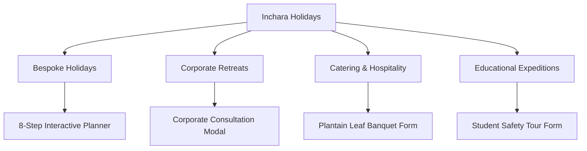
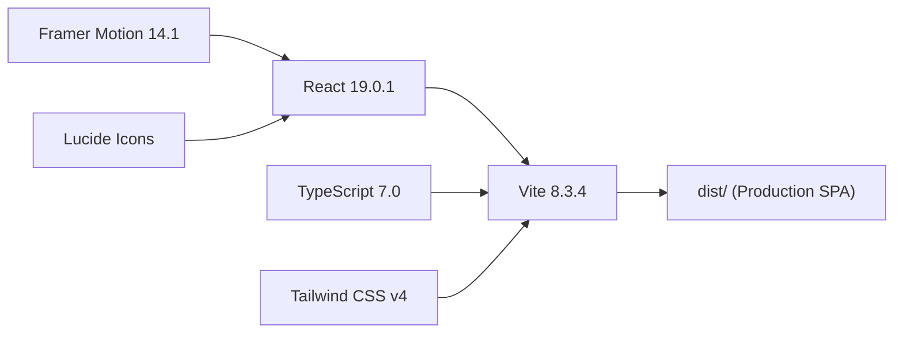

# Inchara Holidays (ಇಂಚಾರಾ ಹಾಲಿಡೇಸ್) — Comprehensive Project Documentation

---

## 1. Executive Summary & Brand Identity

**Inchara Holidays** is a full-featured web application dedicated to experiential, slow, and culturally rooted travel across Karnataka, South India, and international circuits.

* **Brand Tagline**: *Modern journeys rooted in timeless Kannada culture · ಕರಾವಳಿ, ಮಲೆನಾಡು ಹಾಗೂ ಕರ್ನಾಟಕದ ಪರಂಪರೆಯ ನೈಜ ಪ್ರವಾಸ ಅನುಭವ*
* **Core Philosophy**: "Unhurried journeys" (ನಿರಾತಂಕ ಪ್ರಯಾಣ) — prioritizing mindful discovery, direct relationships with heritage homestays and estate owners, traditional plantain-leaf hospitality, and zero high-pressure commercial traps.
* **Target Segments**:
  1. **Discerning Independent Travellers & Families** (Curated nature retreats, temple architecture, coastal getaways).
  2. **Corporate & Executive Teams** (Offsites, executive strategy retreats, team-building in coffee estates).
  3. **Event & Group Hospitality** (Traditional plantain-leaf feast catering, transit packed meals).
  4. **Schools, Colleges & Universities** (Safety-certified experiential educational expeditions).



---

## 2. Visual & Cultural Design Architecture

The visual language is built around an authentic **South Indian / Karnataka Heritage Design System**, combining royal Mysore iconography, Kaavi terracotta threshold art, and Dravidian architectural geometry.

### 2.1 Color Palette & Tokens
| Token Name | Hex Code | Visual Meaning & Usage |
| :--- | :--- | :--- |
| **Forest Evergreen** | `#263F32` | Hoysala stone temples, Western Ghats canopy, primary brand background. |
| **Deep Sacred Green** | `#162E22` | Hero overlay, CTA invitation banner, high-contrast text contrast. |
| **Mysore Royal Gold** | `#D4AF37` | Mysore Palace illumination, Dasara royal accents, hairlines, and buttons. |
| **Kasavu Light Gold** | `#F5D77F` | Golden highlights, badges, kicker text, active border rings. |
| **Kaavi Terracotta** | `#9E3D28` | Traditional temple clay, sacred threshold background for Sikku Kolam. |
| **Warm Sand / Rice Flour** | `#FBF8F1` | Background surface for cards, modals, and readable content panels. |
| **Heritage Silk** | `#F6F3EA` | Primary body background, soft ivory feel avoiding harsh white glare. |

### 2.2 Vector Motifs Component (`src/components/SouthIndianMotifs.tsx`)
Built entirely as responsive, scalable SVGs using `currentColor` and custom gold/terracotta fills:

* **Mysore Dasara Ambari Elephant (`AmbariElephant`)**:
  * Features the ornate royal Howdah (ಅಂಬಾರಿ), decorative headgear (ನೆತ್ತಿಪಟ್ಟಿ), trunk tassel, and ceremonial bell.
  * Used in: Site Header Brand Emblem, Hero royal watermark, Corporate Events badge, CTA banner, and Floating Action planner pill.
* **Dravidian Temple Gopuram (`GopuramIcon`)**:
  * Step-pyramidal sacred temple tower with finial kalashas (ಕಳಶ).
  * Used in: Holiday Packages category badge, Signature Journey route indicator, and heritage circuit cards.
* **Sacred Lotus (`LotusIcon`)**:
  * Multi-petal blooming padma symbolizing serenity, authenticity, and purity.
  * Used in: Section kickers across all core sections, Why Us verification bullets, and Trip Planner modal header.
* **Temple Hanging Bell (`TempleBell`)**:
  * Classic bronze temple bell with hanging chain and clapper (ಘಂಟೆ).
  * Used in: School Expeditions service banner and School Trip modal header.
* **Traditional Ribbed Banana Leaf (`BananaLeafIcon`)**:
  * Natural plantain leaf with organic spine and leaf ribbing.
  * Used in: Catering service banner, food consultation forms, and dining attribute badges.
* **Sikku Kolam Knot Mandala (`SikkuKolamMandala`)**:
  * Authentic Brahma Mudi / Pulli Rangoli interwoven geometric knot mandala.
  * Used as watermark background art in modals, Hero, and Our Story.
* **Continuous Kolam Loop Border Ribbon (`KolamBorderRibbon`)**:
  * Repeating interlinked white-rice flour loop pattern.
  * Runs as an authentic threshold border beneath the site header, modal headers, and footer.

---

## 3. Technology Stack & Dependencies



* **Core Framework**: React 19 (`react`, `react-dom`)
* **Language**: TypeScript (`strict` mode with zero compiler errors)
* **Build System**: Vite v8.3.4 (with `@tailwindcss/vite` and `@vitejs/plugin-react`)
* **Styling Engine**: Tailwind CSS v4 (configured with CSS theme variables, `@theme`, and utility classes)
* **Animation & Motion**: Framer Motion v14 (`framer-motion`) with native `useReducedMotion` support for accessibility
* **Iconography**: `lucide-react` paired with custom cultural vector graphics in `SouthIndianMotifs.tsx`
* **Deployment & CI**: Vercel-ready with `vercel.json` SPA routing rewrites and `.npmrc`

---

## 4. Complete Component Hierarchy & Structure

```
src/
├── main.tsx                         # App bootstrap and React DOM root
├── App.tsx                          # Core application state orchestrator & modal controller
├── index.css                        # Tailwind v4 theme, Kolam SVG patterns, custom fonts
├── types.ts                         # Universal TypeScript definitions & data contracts
│
├── data/
│   ├── translations.ts              # Full Kannada (kn) and English (en) dictionary
│   ├── destinations.ts              # Curated destinations, narratives, coordinates, tags
│   ├── experiences.ts               # Sensory signature experiences
│   └── community.ts                 # Real-voice traveller testimonials
│
├── components/
│   ├── Header.tsx                   # Top navigation, brand emblem, language toggle, quick actions
│   ├── Hero.tsx                     # Full-viewport cinematic landing with Dasara elephant watermark
│   ├── ServicesDiscoverySection.tsx # 4-pillar showcase (Holidays, Corporate, Catering, Schools)
│   ├── DestinationDiscovery.tsx     # Filterable destination catalog with curated blueprints
│   ├── DestinationModal.tsx         # Deep itinerary details, cultural etiquette & phrasebook
│   ├── SignatureJourney.tsx         # Sacred Hoysala & Coastal circuit storytelling strip
│   ├── ExperiencesSection.tsx       # Interactive master-detail experiential showcase
│   ├── WhyUs.tsx                    # 6 core cultural guarantees & lotus bullet points
│   ├── HowItWorks.tsx               # 3-step unhurried planning process
│   ├── TravellerStories.tsx         # Community reflections and guest notes
│   ├── OurStory.tsx                 # Founding philosophy, Malenadu roots, slow travel
│   ├── CtaInvitation.tsx            # Full-bleed closing invitation with gold illumination
│   ├── Footer.tsx                   # Bilingual footer, accreditation, Kolam threshold strip
│   │
│   ├── TripPlannerModal.tsx         # 8-step conversational multi-step wizard
│   ├── CorporateEventModal.tsx      # Corporate offsite & executive retreat inquiry modal
│   ├── CateringModal.tsx            # Plantain leaf feast & group meal inquiry modal
│   ├── SchoolTripModal.tsx          # Safety-certified school/college expedition modal
│   ├── ContactModal.tsx             # Direct contact & enquiry modal
│   │
│   ├── SouthIndianMotifs.tsx        # High-fidelity vector SVGs of all 8 cultural motifs
│   ├── CustomCursor.tsx             # Spring physics cursor with interactive hover detection
│   ├── ScrollProgressBar.tsx        # Top-fixed reading progress indicator
│   └── FloatingActions.tsx          # Bottom-right back-to-top & quick plan trigger
```

---

## 5. Detailed Breakdown of Interactive Modals

Every modal in the application includes:
1. **Isolated Hit Targets**: Close buttons are elevated to `z-50 pointer-events-auto` with `w-10 h-10` circular bounds and active scale feedback.
2. **Keyboard Accessibility**: Complete <kbd>Esc</kbd> key dismiss listener attached via `useEffect`.
3. **Backdrop Dismiss**: Clicking outside the sheet smoothly dismisses the modal.
4. **Header Safe Padding (`pr-12`)**: Guarantees titles or subtitle text never overlap the close button on any screen width.
5. **Mobile Responsiveness**: Sliders render as full-height bottom-sheets on mobile devices (`h-[94dvh]`) and right-docked drawer panels on desktop.

### 5.1 Multi-Step Trip Planner (`src/components/TripPlannerModal.tsx`)
* **8 Conversational Stages**:
  1. *Scope Selection*: Domestic Karnataka / Pan-India / International
  2. *Destinations*: Interactive chip multi-selector + custom text entry
  3. *Timing*: Month selector + date flexibility chips
  4. *Duration*: Interactive stepper (1 to 21 days)
  5. *Travellers*: Solo, Couple, Family with Elders, Friends Group count
  6. *Travel Style*: Nature & Plantations, Heritage & Architecture, Slow Homestays, Coastal Trails
  7. *Comfort Tier*: Authentic Homestay, Premium Boutique, Heritage Palace
  8. *Contact & Delivery*: WhatsApp, Phone, or Email preference
* **Export Features**:
  * One-click summary copy to clipboard with structured Markdown formatting.
  * Direct "Open WhatsApp" action pre-filling the inquiry brief for Inchara Holidays operators.

### 5.2 Destination Detail Modal (`src/components/DestinationModal.tsx`)
* **Hero Banner**: Curated photography with location kicker and tag.
* **Regional Narrative**: In-depth description in Kannada or English.
* **Itinerary Blueprint**: Day-by-day suggested pacing without rushed schedules.
* **Cultural Etiquette Guide**: Traditional temple dress codes, sacred photography rules, and footwear protocols on a Kaavi Terracotta banner (`#9E3D28`).
* **Interactive Kannada Travel Phrasebook**:
  * Phrases include: "ನಮಸ್ಕಾರ" (Namaskara), "ಊಟ ಆಯ್ತಾ?" (Oota aaytha?), "ತುಂಬಾ ಚೆನ್ನಾಗಿದೆ" (Thumba chennagide), "ದಯವಿಟ್ಟು" (Dayavittu), "ಹೋಗಿ ಬರ್ತೀನಿ" (Hogi barteeni).
  * One-click copy with instant feedback.

### 5.3 Corporate Event Modal (`src/components/CorporateEventModal.tsx`)
* Dedicated for leadership retreats, team offsites, and milestone events.
* Fields: Organization name, contact person, work email, phone, attendee count (10-30, 30-75, 75-150, 150+), retreat type (Productivity Sprint, Nature Rejuvenation, Annual Gathering), and audio-visual/activity requirements.

### 5.4 Catering & Hospitality Modal (`src/components/CateringModal.tsx`)
* Dedicated for traditional food arrangements.
* Fields: Guest count, occasion type (Family celebration, transit meal, corporate lunch), service format (Modern Buffet vs. Seated Plantain Leaf "ಪಂಕ್ತಿ ಸೇವೆ"), dietary styles (Pure Veg, Jain / No Onion-Garlic, Malenadu regional delicacies).

### 5.5 Educational Trip Modal (`src/components/SchoolTripModal.tsx`)
* Dedicated for schools and universities.
* Highlights safety protocols: verified bus transport, hygienic meals, dedicated female escorts, and experiential learning focus (geology, architecture, wildlife).

---

## 6. Bilingual Architecture (ಕನ್ನಡ & English)

Language state is maintained at the root in `App.tsx` and distributed through child components:
* Seamless one-click switching in the header.
* Zero external API calls for translation — all copy is curated and stored locally in `src/data/translations.ts`.
* Natural Kannada phrasing tailored to native Malenadu and Karavali expressions rather than literal machine translation.

---

## 7. Build, Dependency & CI/CD Setup

1. **Lockfile & Dependencies**:
   * Removed conflicting `esbuild@0.25` dependency.
   * `package-lock.json` strictly verified with `npm ci`.
   * Conflicting `bun.lock` removed to prevent Vercel package-manager confusion.
2. **Configuration Files**:
   * `.npmrc`: Configured with `legacy-peer-deps=true` for build robustness across different Node.js environments.
   * `vercel.json`: Configured with `framework: "vite"`, `buildCommand: "npm run build"`, `outputDirectory: "dist"`, and SPA wildcard routing rewrites.
3. **Repository Status**:
   * Remote: https://github.com/Srinidhi-070/Inchara-Holidays.git
   * Visibility: **Public**
   * Primary Branch: `main`
   * Local verification: `npm run build` completed in **438ms**; `npx tsc --noEmit` passed with **0 errors**.
