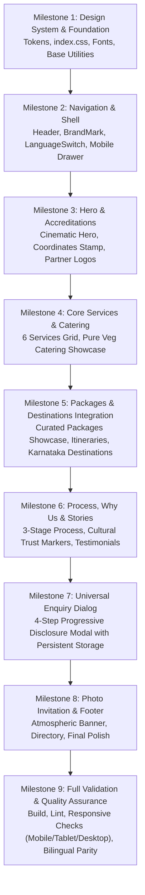

# INCHARA HOLIDAYS — UI INTEGRATION PLAN
## Refactoring & Synthesizing the New Figma Design with Existing Website Content

**Document Version**: 1.0.0  
**Date**: November 7, 2026  
**Architect**: Senior Frontend Architect & Design Systems Engineer  
**Source Visual Authority**: `new_ui_design/Redesign Inchara Holidays Website/`  
**Content & Feature Authority**: Existing Inchara Holidays Codebase (`src/`)  

---

## 1. Executive Summary & Core Principle

This integration is **not a rewrite from scratch** and **not a discard of past work**. It is an intentional, architected fusion:
- **Visual Design Authority**: The newly approved Figma design (`new_ui_design/`) provides the modern, quiet-luxury layout, typography rules, refined color tokens, fluid spacing, and semantic component styles.
- **Content & Functionality Authority**: The existing website provides the rich business reality—real Karnataka destination data (10 destinations), curated holiday packages (6 packages with day-by-day itineraries), verified partner accreditations (KTF, IATTE, ABTO, UTEN), cultural motifs, dual Kannada/English copy, and comprehensive universal enquiry logic.

**Core Rule**: No valuable existing content, service details, or itinerary data will be deleted. Where the new design omitted sections (such as packages or destinations), those sections will be adapted and brought into the new design system.

---

## 2. New Design Structure Analysis (`new_ui_design/`)

The new Figma design establishes a cohesive, semantic architecture:
1. **Global Shell & Base CSS (`src/index.css`)**:
   - Tailwind v4 `@theme` block with formal tokens: `--color-forest: #162e22`, `--color-night: #0a1810`, `--color-footer: #0f261a`, `--color-gold: #d4af37`, `--color-pale-gold: #f5d77f`, `--color-terracotta: #9e3d28`, `--color-sand: #fbf8f1`, `--color-parchment: #f6f3ea`, `--color-ink: #12261c`.
   - Native font stacks: `Cormorant Garamond` (English display serif), `Inter` (English UI/body), `Noto Serif Kannada` (Kannada display), `Noto Sans Kannada` (Kannada UI).
   - Clean, lightweight scroll-reveal mechanism without heavy external dependencies.
   - Built-in accessibility: `.skip-link`, clear `:focus-visible` styling with gold outlines, high-contrast selection colors.
2. **Sticky Header (`Header.tsx`)**:
   - Frosted forest glass (`backdrop-blur`), bilingual brand lockup, desktop anchor navigation to services, accessible language switcher (`en` / `kn`), and signature gold CTA button.
   - Fully accessible mobile drawer with keyboard focus trap, ARIA attributes, and escape key listener.
3. **Hero Section (`HomeSections.tsx` -> `Hero`)**:
   - Cinematic full-bleed Western Ghats landscape, coordinates stamp (`12° 58′ N · 75° 46′ E`), bilingual headline, gold enquiry CTA, secondary anchor button, and subtle scroll cue.
4. **Trust / Affiliation Strip (`HomeSections.tsx` -> `Affiliations`)**:
   - Transition band presenting KTF, IATTE, ABTO, and UTEN.
5. **Six-Service Editorial Showcase (`HomeSections.tsx` -> `Services`)**:
   - 2-column asymmetric grid for the 6 services with numbered tags (`01`–`06`), custom vector icons, feature lists, and contextual enquiry links.
6. **Signature Pure Veg Catering Feature (`HomeSections.tsx` -> `CateringFeature`)**:
   - Parchment/terracotta backdrop with banana-leaf feast photography, "ಅತಿಥಿ ದೇವೋ ಭವ" emblem seal, dietary accommodation badges, and dedicated enquiry CTA.
7. **Brand Journey Process (`HomeSections.tsx` -> `JourneyProcess`)**:
   - 3-stage unhurried narrative: `01 Listen` → `02 Shape` → `03 Host`.
8. **Closing Invitation Banner (`HomeSections.tsx` -> `InvitationBanner`)**:
   - Atmospheric tea plantation photography with vignette, gold hairlines, editorial serif headline ("Where will your heart take you next?"), and gold CTA button.
9. **Footer (`Footer.tsx`)**:
   - Deep forest green directory with 6 service links, language switch, operational notes, and copyright.
10. **Universal Enquiry Dialog (`EnquiryDialog.tsx`)**:
    - 4-step progressive disclosure flow: `1. Service` → `2. Details` → `3. Contact` → `4. Review`.

---

## 3. Existing Website Structure & Content Audit (`src/`)

The existing website holds rich, verified assets and functionality:
1. **Curated Holiday Packages (`src/data/packages.ts`)**:
   - 6 fully structured packages:
     * *Misty Western Ghats Heritage* (5D/4N - Coorg & Chikmagalur)
     * *Hoysala Splendour & Royal Mysore* (4D/3N - Belur, Halebidu, Mysore)
     * *Coastal Karnataka & Sacred Sands* (6D/5N - Gokarna, Murudeshwar, Udupi)
     * *Hampi Vijayanagara Empire Trail* (4D/3N - Hampi & Badami)
     * *Classic Golden Triangle & Rajasthan* (7D/6N - Delhi, Agra, Jaipur)
     * *Kerala Backwaters & Mist Trails* (6D/5N - Munnar & Alleppey)
   - Includes highlights, duration, day-by-day itineraries, inclusions, exclusions, and pricing status.
2. **Destination Catalog (`src/data/destinations.ts`)**:
   - 10 detailed destinations with Kannada names, district coordinates, curated descriptions, top cultural sights, and best travel seasons.
3. **Travel Experiences (`src/data/experiences.ts`)**:
   - 6 distinct experiential categories: Heritage & Temple Architecture, Misty Hills & Coffee Trails, Coastal & Sacred Waters, Wildlife & Forest Sanctuaries, Pure Vegetarian Culinary Trails, and Educational Industrial Visits.
4. **Verified Accreditations (`src/components/WhyUs.tsx` & `public/images/partners/`)**:
   - High-contrast, trimmed official logos for KTF, IATTE, ABTO, and UTEN on circular backdrops.
5. **Authentic Cultural Motifs (`src/components/SouthIndianMotifs.tsx`)**:
   - Vector SVG assets: `AmbariElephant`, `LotusIcon`, `SikkuKolamMandala`, `KolamBorderRibbon`.
6. **Traveller Stories & Testimonials (`src/data/community.ts`)**:
   - Real customer reflections highlighting personalized planning, punctual drivers, and pure vegetarian food arrangements.
7. **Enquiry Management Pipeline (`src/services/inquiryService.ts` & `src/types/inquiry.ts`)**:
   - Typed payload generation, client-side persistence, unique reference number generation (`INC-YYYYMMDD-XXXX`), status workflow (`new`, `contacted`, `converted`, `closed`).
8. **Brand Configuration (`src/config/brand.ts`)**:
   - Centralized operational coordinates, verified WhatsApp inquiry URL generators, and business contact points.

---

## 4. New-to-Old Section Mapping & Synthesis Matrix

| Homepage Section | New Figma Design Component | Existing Website Source | Synthesis Strategy & Decision |
| :--- | :--- | :--- | :--- |
| **Header & Nav** | `Header.tsx` (new_ui_design) | `Header.tsx` (existing) | **Adopt New Layout**: Use new sticky frosted header, desktop anchor links, and mobile drawer. **Preserve**: Existing royal Ambari SVG mark and brand lockup. |
| **Hero** | `Hero` (`HomeSections.tsx`) | `Hero.tsx` (existing Concepts A, B, C) | **Adopt New Layout**: Full-bleed cinematic Western Ghats hero with coordinates stamp and gold CTA. Incorporate existing bilingual typography refinements. |
| **Accreditations Strip** | `Affiliations` (`HomeSections.tsx`) | `WhyUs.tsx` (existing) | **Merge & Elevate**: Use the new clean container styling, but replace text-only placeholders with the **existing verified high-contrast partner logos** (KTF, IATTE, ABTO, UTEN). |
| **Six Services Grid** | `Services` (`HomeSections.tsx`) | `ServicesDiscoverySection.tsx` (existing) | **Adopt New Editorial Layout**: Render the 6 service cards (Holidays, Education, Corporate, Transport, Visa, Catering) with new card geometry, icons, and contextual enquiry triggers. |
| **Featured Packages** | *Absent in new design* | `PackagesSection.tsx` & `packages.ts` | **Integrate & Redesign**: Adapt the 6 curated holiday packages into the new visual system using new parchment card styling, gold hairlines, and enquiry CTAs. **Do not omit!** |
| **Destinations & Experiences** | *Absent in new design* | `DestinationsSection.tsx`, `ExperiencesSection.tsx`, `destinations.ts` | **Integrate & Redesign**: Create a refined showcase for Karnataka destinations and travel experiences using the new quiet-luxury design tokens. |
| **Pure Veg Catering Showcase** | `CateringFeature` (`HomeSections.tsx`) | `CateringShowcase.tsx` (existing) | **Merge**: Combine new layout (banana-leaf feast image, "ಅತಿಥಿ ದೇವೋ ಭವ" seal) with existing rich copy (scalable 50 to 2000+ guests, Jain-friendly options, tour kitchens). |
| **Why Us / Cultural Values** | *Brief in new design* | `WhyUs.tsx` (existing) | **Integrate**: Feature the authentic differentiators (Zero commercial kickbacks, Malenadu rooted hospitality, transparent pricing). |
| **Process / How It Works** | `JourneyProcess` (`HomeSections.tsx`) | `HowItWorks.tsx` (existing) | **Adopt New Layout**: Use the sleek 3-stage narrative (`01 Listen`, `02 Shape`, `03 Host`) styled with new typography. |
| **Testimonials / Stories** | *Absent in new design* | `TravellerStories.tsx` & `community.ts` | **Integrate & Redesign**: Present genuine traveller stories in an unhurried, editorial card layout matching the new aesthetic. |
| **Photo Invitation Banner** | `InvitationBanner` (`HomeSections.tsx`) | Redesigned `Footer.tsx` invitation banner | **Adopt New Layout**: Cinematic Western Ghats banner with multi-stop atmospheric lighting, Cormorant Garamond serif headline, and signature Mysore Gold CTA. |
| **Footer Directory** | `Footer.tsx` (new_ui_design) | `Footer.tsx` (existing) | **Merge**: Use the new clean, structured layout while retaining existing comprehensive navigation links and legal information. |
| **Enquiry Experience** | `EnquiryDialog.tsx` (new_ui_design) | `UniversalEnquiryModal.tsx` & `inquiryService.ts` | **Merge**: Use the new modern 4-step modal UI (`Service` → `Details` → `Contact` → `Review`), powered under the hood by the existing robust service-specific field schemas, validation, and persistent storage adapter. |

---

## 5. Content & Feature Preservation Inventory

### Content to Preserve 100%:
1. **All 6 Service Categories**:
   - Holiday Packages (Domestic, International, Custom)
   - Educational & Institutional Tours (School excursions, industrial visits)
   - Corporate & Event Tours (Leadership offsites, retreats, conferences)
   - Transportation & Bookings (Coach/bus hire, rail, flight assistance)
   - Travel Assistance (Visa checklists, application guidance, passport facilitation)
   - Catering & Hospitality (100% Pure Veg Pankti Seva, tour kitchens, community dining)
2. **Holiday Packages & Itineraries**:
   - All 6 packages from `packages.ts` with durations, day-by-day itineraries, inclusions, exclusions, and starting prices where available.
3. **Destination Knowledge**:
   - All 10 destinations from `destinations.ts` with cultural contexts, seasonal advice, and sightseeing highlights.
4. **Bilingual Completeness**:
   - Native Kannada copy across all headings, subtitles, buttons, form fields, validation states, and confirmation messages.
5. **Verified Partner Logos**:
   - High-contrast SVG/PNG logos for KTF, IATTE, ABTO, and UTEN.
6. **Inquiry Data Model & Storage**:
   - Schema handling service-specific metadata, generation of inquiry reference numbers (`INC-...`), and local persistence.

---

## 6. Components Evolution Matrix

| Component Name | Action | Details |
| :--- | :--- | :--- |
| `Header.tsx` | **Redesign** | Adopt new sticky frosted shell, brand mark, bilingual switch, desktop anchor links, and mobile focus-trapped drawer. |
| `Hero.tsx` | **Redesign** | Adopt new full-bleed Western Ghats hero, coordinates stamp, and gold CTA. |
| `Affiliations.tsx` / `WhyUs.tsx` | **Merge** | Combine new trust section structure with existing verified partner logos. |
| `ServicesDiscoverySection.tsx` | **Redesign** | Adopt new 6-card editorial layout with numbered badges and icons. |
| `PackagesSection.tsx` | **Redesign & Integrate** | Re-style the packages showcase using new parchment card surfaces, gold hairlines, and itinerary preview dialog. |
| `DestinationsSection.tsx` | **Redesign & Integrate** | Re-style destination cards using the new visual tokens and fluid grid. |
| `CateringShowcase.tsx` | **Redesign** | Merge new `CateringFeature` layout with existing detailed banquet copy. |
| `HowItWorks.tsx` | **Redesign** | Adopt new `JourneyProcess` 3-stage layout with new typography. |
| `TravellerStories.tsx` | **Redesign** | Style testimonials with new quiet-luxury card treatments. |
| `CtaInvitation.tsx` | **Redesign** | Adopt new `InvitationBanner` layout with signature gold button. |
| `Footer.tsx` | **Redesign** | Clean 4-column directory with full service links, language switcher, and operational note. |
| `UniversalEnquiryModal.tsx` | **Redesign & Upgrade** | Adopt new 4-step stepper UI (`EnquiryDialog`) backed by existing comprehensive validation and storage logic. |
| `DestinationModal.tsx` | **Retain & Restyle** | Keep available for in-depth destination itineraries and cultural etiquette. |
| `AdminDashboard.tsx` | **Preserve Unchanged** | Preserve file for future backend phase; do not alter or expose in primary public flow. |

---

## 7. Phased Implementation Roadmap

- **Milestone 1**: Design tokens, global styles, typography setup (`Cormorant Garamond`, `Inter`, `Noto Serif Kannada`, `Noto Sans Kannada`).
- **Milestone 2**: Global shell, sticky navigation header, accessible mobile menu, bilingual state persistence.
- **Milestone 3**: Cinematic Western Ghats hero, coordinates stamp, and verified accreditations row with partner emblems.
- **Milestone 4**: 6-service editorial cards grid and signature pure vegetarian catering showcase.
- **Milestone 5**: Curated holiday packages showcase (`packages.ts`) and Karnataka destination discovery (`destinations.ts`) integrated into the new design.
- **Milestone 6**: Brand journey process (`01 Listen`, `02 Shape`, `03 Host`), cultural differentiators, and traveller stories.
- **Milestone 7**: Universal enquiry dialog synthesis (4-step stepper + service-specific fields + local storage persistence).
- **Milestone 8**: Closing photo invitation banner, structured footer directory, and legal note.
- **Milestone 9**: End-to-end testing, TypeScript verification (`tsc --noEmit`), build check (`vite build`), responsive audit across mobile/tablet/desktop, and dual-language validation.

---

## 8. Acceptance Criteria

1. **Zero Content Regression**: All 6 services, 6 packages, 10 destinations, and partner accreditations remain discoverable.
2. **Visual Fidelity**: Faithful execution of the new Figma design's quiet-luxury aesthetic, color palette, and typography.
3. **Bilingual Parity**: 100% of visible strings, labels, validation, and confirmation messages fully translated in English and Kannada with no clipped glyphs.
4. **Primary Conversion Action**: Universal enquiry modal accessible from header and all contextual CTAs with progressive disclosure.
5. **No Broken Interactions**: Zero console errors, passing TypeScript checks, and passing production Vite build.
6. **Mobile Excellence**: Responsive layouts tailored for 320px–430px mobile displays with touch targets >= 44px.

---
*Integration Plan authored by Senior Frontend Architect. Proceeding to create initial REPORT.md.*
