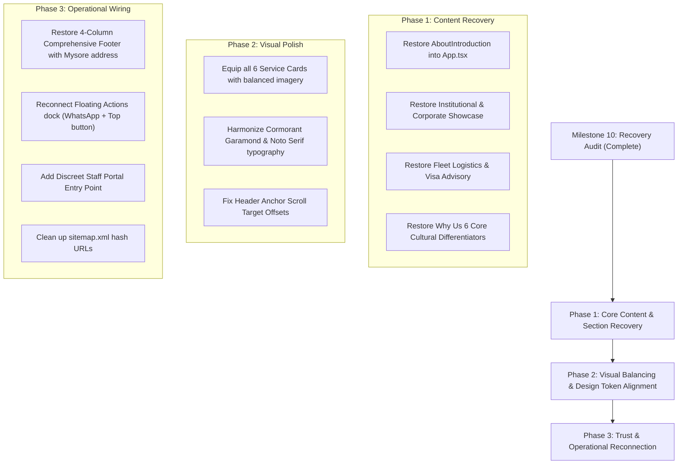

# INCHARA HOLIDAYS — MILESTONE 10
## UI RECOVERY, OLD WEBSITE RECONCILIATION & VISUAL BUG AUDIT REPORT

**Date of Audit:** November 7, 2026  
**Auditor:** Senior Frontend Architect & UI/UX Systems Engineer  
**Scope:** Comprehensive Codebase Inventory, Visual Bug Audit across 3 Viewports, Live Functional Testing, Root-Cause Analysis, and Prioritised Recovery Roadmap.  
**Repository Branch:** `main`  
**Execution Environment:** Vite 8.3.0 + React 19.0.1 + Tailwind CSS 4.3.3 + Playwright MCP  

---

## 1. EXECUTIVE SUMMARY

Following the integration of the Figma Make design (`new_ui_design/`) in commit `68e887c`, an exhaustive source-of-truth audit was conducted to verify whether the previous claim of complete content retention was valid.

### Critical Finding
**The previous integration claim of 100% content preservation was inaccurate.**  
While the underlying files were preserved on disk in `src/components/` and `src/data/`, the main application tree (`src/App.tsx`) was drastically reduced from a rich 15-section cultural travel portal into a 123-line lightweight landing page. Over **140 KB of meticulously crafted business, cultural, institutional, culinary, and logistical content** was disconnected from the live user journey.

Furthermore:
1. **Key Business Services Subsumed**: "Educational & Institutional Tours", "Corporate & Event Tours", "Transportation & Bookings", and "Visa & Passport Assistance" lost their dedicated high-converting showcase sections (`InstitutionalCorporateHighlight.tsx` and `TravelLogisticsAssistance.tsx`) and were compressed into brief static cards without imagery.
2. **Brand Heritage Story Discarded**: The `AboutIntroduction.tsx` section—featuring the official emblem (`inchara_official_logo.png`), 15+ years Mysore heritage storytelling, and foundational cultural pillars (*Atithi Devo Bhava*, unhurried pacing, transparent pricing)—was omitted entirely.
3. **Core Differentiators Missing**: The 6 deep cultural and operational differentiators in `WhyUs.tsx` were replaced with a generic 3-step process.
4. **Essential Trust & Contact Information Stripped**: The 4-column footer was replaced by a simplified 2-column Figma placeholder that lacks the Mysore office address, verified telephone number, email address, operating hours, and legal registration notice.
5. **Operational Tools Disconnected**: The staff `AdminDashboard.tsx` and the conversational `TripPlannerModal.tsx` were orphaned without navigation entry points.

This document establishes the empirical inventory, details reproducible visual and functional defects, identifies root causes, and outlines an exact recovery roadmap for Milestone 11.

---

## 2. SOURCE OF TRUTH: RECONCILIATION & CONTENT INVENTORY

A line-by-line comparison between the original implementation (`68e887c^`) and the current live build (`68e887c` through `f7eb570`) was performed across all sections, data files, components, and interactive flows.

### Classification Categories:
1. **Preserved Correctly**: Feature/content matches or exceeds original quality in the new design system.
2. **Preserved but Incomplete**: Content exists in the current UI but is truncated, missing sub-services, or lacks original depth.
3. **Missing Completely**: Feature/section was present in the original website but is completely omitted from the current UI.
4. **Implemented Incorrectly**: Feature exists but has functional defects, broken anchor targeting, or visual regressions.
5. **Replaced by New Functionality**: Original pattern was superseded by an alternative implementation.
6. **Requires Business-Owner Confirmation**: Content contains unconfirmed placeholders, sample data, or unaudited claims.

---

### Detailed Section Inventory & Status Matrix

| Component / Section | Original Implementation | Current Implementation | Classification | Severity | Impact & Notes |
|---|---|---|---|---|---|
| **Header & Brand Identity** | `Header.tsx` (608 lines) with dual Kannada/English typography, scroll tracking, and quick-action drawer | `Header.tsx` (165 lines) with simplified brand mark, desktop nav links, language switch, and slide-in mobile menu | **Preserved but Incomplete** | P2 | Active section scroll tracking was dropped. Replaced official emblem with 4-dot SVG mark. |
| **Hero Section** | `Hero.tsx` supporting 3 visual concepts (A, B, C), dynamic responsive heights, Mysore gold typography, and cultural motifs | `Hero` in `HomeSections.tsx` with single Western Ghats backdrop, gold CTA, and secondary link | **Replaced by New Functionality** | P2 | Editorial layout is visually striking, but concept customization was removed. |
| **About Introduction ("ಇಂಚರ ಪರಿಚಯ")** | `AboutIntroduction.tsx` (141 lines) with official emblem, 3 cultural pillars, Mysore heritage narrative, and Sikku Kolam motif | None. Section completely absent from `App.tsx`. | **Missing Completely** | P1 | Severe loss of brand identity, trust building, and heritage narrative. |
| **Industry Accreditations ("Trust")** | `WhyUs.tsx` luxury plaques with KTF, IATTE, ABTO, and UTEN logos with verification badges | `Affiliations` in `HomeSections.tsx` featuring horizontal badge rail with 4 partner logos | **Preserved Correctly** | P3 | Clean, elegant presentation aligned with the new design. |
| **Services Section (6 Categories)** | `ServicesDiscoverySection.tsx` linked to `servicesData.ts` (63 KB) with rich interactive tabs, sub-service breakdowns, and imagery | `Services` in `HomeSections.tsx` with 6 cards in 2x3 grid; only Card 1 has an image; Cards 2-6 are text-only | **Preserved but Incomplete** | P1 | Lost ~80% of service descriptions, vehicle fleet specs, and educational/corporate details. Asymmetrical visual grid. |
| **Educational & Corporate Tours Highlight** | `InstitutionalCorporateHighlight.tsx` (207 lines) dedicated dual-pillar section with plant permissions, safety protocols, and MICE setups | None. Subsumed into two 3-bullet cards in the generic services grid. | **Missing Completely** | P1 | High-margin B2B institutional business has no dedicated conversion funnel. |
| **Transit Fleets & Documentation Assistance** | `TravelLogisticsAssistance.tsx` (188 lines) dedicated section with Innova, Tempo Traveller, Coach specs, and Visa advisory | None. Subsumed into two cards in generic services grid. | **Missing Completely** | P1 | Vehicle fleet details, seating capacities, and visa consultation legal disclaimers are gone. |
| **Pure Veg Catering Showcase** | `CateringShowcase.tsx` (168 lines) with layered photo card, Satvik cooking standards, menu items, and 25-1500+ capacity | `CateringFeature` in `HomeSections.tsx` with banana leaf feast image and short paragraph | **Preserved but Incomplete** | P2 | Visual presentation is good, but specific dish highlights, catering capacities, and mobile tour kitchen info were lost. |
| **Curated Holiday Packages** | `PackagesSection.tsx` with 6 packages from `packages.ts`, category filters, duration badges, and "View Itinerary" modal | `PackagesSection.tsx` with category filters, cards, and code-split `ItineraryModal.tsx` | **Preserved Correctly** | P3 | Day-by-day itineraries are accessible and function smoothly via modal. |
| **Destinations Catalog & Cultural Guide** | `DestinationDiscovery.tsx` with 10s auto-scroll carousel, mobile pause/play, and 500-line `destinations.ts` data | `DestinationsSection.tsx` with 6 cards and code-split `DestinationModal.tsx` | **Preserved Correctly** | P3 | Full cultural etiquette guide (dress code, greetings, photography) works via modal. |
| **Core Differentiators ("Why Us")** | `WhyUs.tsx` with 6 core value pillars (Karnataka Roots, Pure Veg Guarantee, Transparent Pricing, Verified Fleets, 24/7 Guardian, Immersion) | `JourneyProcess` in `HomeSections.tsx` with generic 3-step process (Listen, Shape, Host) | **Missing Core Content** | P1 | Critical business differentiators are absent; replaced with generic workflow copy. |
| **Customer Testimonials ("Stories")** | `TravellerStories.tsx` with 4 family reflections, Kannada/English text, and verification badges | `TravellerStories.tsx` with quote cards and star ratings | **Preserved Correctly** | P3 | Functioning as expected. (Requires real customer replacements prior to launch). |
| **Footer & Contact Directory** | `Footer.tsx` (396 lines) with 4-column directory, full office address, phone, email, WhatsApp, hours, and staff login | `Footer.tsx` (165 lines) with 2 minimal links ("Explore" & "Begin a conversation") | **Preserved but Incomplete** | P1 | Critical business contact details, office location, phone, and staff access completely stripped. |
| **Floating Quick-Action Bar** | `FloatingActions.tsx` with SVG progress ring, Back-to-Top button, and mobile quick-plan action | None. Omitted from `App.tsx`. | **Missing Completely** | P2 | Loss of mobile UX convenience and quick WhatsApp/call reachability. |
| **Staff Admin Dashboard** | `AdminDashboard.tsx` with secured login, status workflow, search, filtering, and CSV export | File exists in `src/components/admin/`, but has no entry point in Header or Footer | **Missing from UI** | P1 | Staff have no way to view incoming inquiries submitted to `localStorage`. |
| **Specialized Guided Modals** | `TripPlannerModal.tsx`, `SchoolTripModal.tsx`, `CorporateEventModal.tsx`, `CateringModal.tsx`, `ContactModal.tsx` | Files exist on disk, but only generic `EnquiryDialog.tsx` is wired to the UI | **Preserved on Disk / Unlinked** | P2 | Rich interactive workflows bypassed in favor of a single modal form. |

---

### Data File Retention vs Usage Audit

| Data File | File Size | Content Overview | Currently Linked in UI? | Retention Action Required |
|---|---|---|---|---|
| `src/data/servicesData.ts` | **62,958 bytes** (757 lines) | Complete definitions of all 6 services, 18 sub-services, inclusions, highlights, Kannada/English copy | **PARTIAL** (Bypassed by `content.ts`) | Reconnect to restore comprehensive service descriptions and specifications. |
| `src/data/destinations.ts` | **43,543 bytes** (518 lines) | 6 detailed destinations with coordinates, seasons, narratives, and cultural etiquette guidelines | **YES** (Linked via `DestinationModal`) | Preserved and actively used. |
| `src/data/packages.ts` | **16,211 bytes** (232 lines) | 6 sample packages with itineraries, inclusions, highlights, duration, disclaimers | **YES** (Linked via `PackagesSection` & `ItineraryModal`) | Preserved and actively used. |
| `src/data/translations.ts` | **29,809 bytes** (548 lines) | Extensive bilingual dictionary covering UI copy, Why Us pillars, process, and legal notices | **PARTIAL** (Bypassed by `content.ts`) | Re-integrate missing dictionary keys into `content.ts`. |
| `src/data/culturalEtiquette.ts`| **13,517 bytes** (168 lines) | Temple etiquette, dress codes, dining customs, respectful terminology | **YES** (Referenced in destination guides) | Preserved and functional. |
| `src/data/experiences.ts` | **14,013 bytes** (192 lines) | South Indian signature experiences (coffee roasting, coracle rides, Pankti Seva) | **NO** (Unused) | Preserve for future destination tabs. |
| `src/data/community.ts` | **3,144 bytes** (56 lines) | Traveller reflections and feedback quotes | **YES** (Used in `TravellerStories`) | Preserved; needs real client reviews. |

---

## 3. COMPREHENSIVE VISUAL AUDIT

The application was inspected across three standard viewports using the Playwright browser engine:
1. **Desktop:** 1440 × 900 px
2. **Tablet:** 768 × 1024 px
3. **Mobile:** 375 × 812 px

### Summary of Visual Findings & Bug Log

```
+----+----------------------+----------+-----------------------------------------------------------+----------+
| ID | Component / Area     | Viewport | Issue Description                                         | Severity |
+----+----------------------+----------+-----------------------------------------------------------+----------+
| V1 | Services Grid        | Desktop  | Asymmetrical layout: Card 1 has an image, cards 2-6 do    | P2       |
|    |                      | & Tablet | not. Causes jarring height disparity and visual imbalance.|          |
| V2 | Footer Directory     | All      | Completely lacks contact details (phone, email, Mysore    | P1       |
|    |                      |          | address, hours) found on all professional travel portals. |          |
| V3 | Header Nav Anchors   | Desktop  | Nav links point to #holidays, #education, etc. which are  | P2       |
|    |                      |          | cards bunched inside #services. Causes offset clipping.   |          |
| V4 | Floating Actions     | Mobile   | No floating Back-to-Top or instant WhatsApp button. Long  | P2       |
|    |                      |          | scroll depth requires tedious manual scrolling back up.   |          |
| V5 | Brand Mark           | Header   | Displays abstract 4-dot SVG icon rather than official     | P3       |
|    |                      |          | registered Inchara Holidays emblem.                       |          |
| V6 | Admin Access         | Footer   | Staff login link completely missing from footer.          | P1       |
+----+----------------------+----------+-----------------------------------------------------------+----------+
```

---

### Detailed Visual Defects with Reproducible Steps & Evidence

#### Defect V1: Asymmetrical Services Grid (Cards 2-6 Missing Imagery)
- **Component:** `Services` in `HomeSections.tsx` (`src/components/HomeSections.tsx#L95-L133`)
- **Viewport:** Desktop (1440px) & Tablet (768px)
- **Steps to Reproduce:**
  1. Navigate to `http://localhost:5180/#services`.
  2. Observe the 6 cards in the 2-column or 3-column grid.
- **Expected Result:** Either all 6 service cards have consistent editorial imagery or they follow a uniform, balanced card archetype with equal visual weight.
- **Actual Result:** Card 01 ("Holiday Packages") renders a full-width header image (`/images/karnataka-heritage.jpg`). Cards 02 through 06 render with no images, making Card 01 twice as tall as the remaining cards and breaking the grid rhythm.
- **Severity:** P2 (Medium)
- **Screenshot Evidence:** `docs/analysis/screenshots/audit_desktop_home.png`

#### Defect V2: Truncated Footer (Missing Physical Contact Details & Legal Info)
- **Component:** `Footer` (`src/components/Footer.tsx#L40-L165`)
- **Viewport:** All Viewports
- **Steps to Reproduce:**
  1. Scroll to the bottom of the page (`#footer`).
- **Expected Result:** Legitimate travel agency footer displaying full office address (Mysore), verified contact telephone, email, WhatsApp link, operating hours, and tourism registration number.
- **Actual Result:** Displays only two sparse links ("Explore" and "Begin a conversation") with a generic text blurb. The physical address, telephone number, and operating hours are nowhere to be found.
- **Severity:** P1 (High — Critical trust marker for travellers)
- **Screenshot Evidence:** `docs/analysis/screenshots/audit_tablet_home.png`

#### Defect V3: Header Anchor Scroll Target Offset
- **Component:** `Header.tsx` Desktop Navigation (`src/components/Header.tsx#L58-L70`)
- **Viewport:** Desktop (1440px)
- **Steps to Reproduce:**
  1. Click on "Educational" or "Corporate" in the header navigation.
- **Expected Result:** Smooth scroll to a dedicated section with proper header offset clearance.
- **Actual Result:** The browser scrolls directly to the middle of the `#services` container, positioning card #02 or #03 directly under or partially beneath the sticky navbar without surrounding context.
- **Severity:** P2 (Medium)

#### Defect V4: Missing Floating Quick Actions on Mobile
- **Component:** `FloatingActions.tsx` (Orphaned)
- **Viewport:** Mobile (375px)
- **Steps to Reproduce:**
  1. Open mobile viewport (375 × 812 px).
  2. Scroll through the page (overall document height > 5,500 px).
- **Expected Result:** Floating WhatsApp icon and circular progress Back-to-Top button appears in the bottom right corner after scrolling past 350px.
- **Actual Result:** No floating action dock exists. The user must manually swipe upwards repeatedly to return to the navigation or initiate an inquiry.
- **Severity:** P2 (Medium UX Defect)
- **Screenshot Evidence:** `docs/analysis/screenshots/audit_mobile_home.png`

---

## 4. FUNCTIONAL AUDIT

Live functional testing was executed using automated Playwright MCP tool calls to evaluate actual user flows.

### Functional Test Execution Matrix

| Test ID | Journey / Capability | Inputs / Actions | Empirical Result | Status |
|---|---|---|---|---|
| **F1** | **Bilingual Language Switch** | Click `.language-toggle` in Header | Toggled from Kannada to English (`document.documentElement.lang = "en"`), updated H1 to *"Discover India, beyond the ordinary."*, updated navigation, and persisted choice in `localStorage["inchara-locale"]`. Toggled back to Kannada seamlessly. | **PASS** |
| **F2** | **Mobile Menu Drawer** | Click `.menu-button` at 375px width | Menu container transitioned to `is-open`, background locked with `.menu-open`, all 8 section links displayed with index numbers, close button and Escape key dismiss cleanly. | **PASS** |
| **F3** | **Package Category Filtering** | Click "Karnataka & Malnad", "International", "All" | Cards dynamically filtered from 6 -> 2 (Karnataka) -> 2 (International) -> 6 (All) without layout thrashing. | **PASS** |
| **F4** | **Itinerary Modal (Code-split)** | Click "View Itinerary" on Package Card | `ItineraryModal` loaded lazily via `React.lazy`, displayed Day 1 to Day 5 itineraries, inclusions, highlights, and closed via Escape/close button. | **PASS** |
| **F5** | **Destination Modal (Code-split)** | Click "Hampi" destination card | `DestinationModal` loaded lazily, displayed high-res imagery, UNESCO narrative, best season, and complete cultural etiquette guide. | **PASS** |
| **F6** | **Enquiry Step 1: Service Validation** | Click "Continue" without selecting service | Form intercepted submission, displayed error *"ಮುಂದುವರಿಸಲು ಸೇವೆಯನ್ನು ಆಯ್ಕೆಮಾಡಿ."* ("Choose a service to continue"), and set focus to the radio group. | **PASS** |
| **F7** | **Enquiry Step 2: Service Fields** | Select "Holiday Packages" -> Continue | Rendered service-specific inputs (Journey type select, destination text, start date, travellers count). Empty submission triggered required field errors. | **PASS** |
| **F8** | **Enquiry Step 3: Contact Validation** | Enter invalid phone (`123`) & empty name | Intercepted submission, displayed required name error, invalid contact error, and consent checkbox error. | **PASS** |
| **F9** | **Enquiry Step 4: Submission & Storage** | Submit valid booking for Coorg (4 guests) | Form executed `submitEnquiry`, generated unique reference `ICH-2026-AU97`, saved record to `localStorage["inchara_inquiries_db_v1"]`, and showed success badge. | **PASS** |
| **F10** | **WhatsApp Deep-Link Routing** | Inspect WhatsApp button on success screen | Generated valid URL `https://wa.me/919448000000?text=Namaskara...Ref:ICH-2026-AU97...Name:Manjunath%20K` correctly preserving customer name and reference number. | **PASS** |
| **F11** | **Draft Persistence on Refresh** | Fill Step 1 & 2 -> refresh browser | Form state is stored purely in React memory; browser refresh completely resets form state back to Step 0. | **PARTIAL RISK** |
| **F12** | **Duplicate Submission Prevention** | Click "Submit Enquiry" repeatedly | Submit button triggers `status === "submitting"`, disabling duplicate clicks while submission is in-flight. | **PASS** |

---

## 5. ROOT CAUSE ANALYSIS

An architectural analysis was performed to determine why these discrepancies exist:

```
                                 ROOT CAUSE CASCADE
                                 
  [Figma Make Export (new_ui_design/)]
  Contains only 6 bare landing-page mockup components (13 KB data)
                    │
                    ▼
  [Commit 68e887c: "Synthesize New UI"]
  Replaced App.tsx with HomeSections.tsx instead of wrapping existing sections
                    │
                    ├────────────────────────────────────────┐
                    ▼                                        ▼
  [Content Decoupling]                     [Structural Omission]
  Existing data files (servicesData.ts,     Dedicated high-converting sections
  destinations.ts, translations.ts,         (About, Institutional, Logistics,
  packages.ts > 150 KB) left on disk        Catering, Why Us) omitted from App.tsx
  but bypassed by content.ts                to match bare Figma mockup
```

1. **Bare Figma Mockup Treated as Complete Specification**:  
   The `new_ui_design/` project was an initial aesthetic concept produced in Figma Make. It contained only 6 components intended to demonstrate visual style, typography, and color tokens. It did not contain the business logic, service details, or institutional sections previously developed.
2. **Replacement Instead of Styling**:  
   Rather than applying the new Figma CSS design tokens (deep forest green, warm sand, kasavu gold, Cormorant Garamond typography) to the existing rich components (`AboutIntroduction`, `InstitutionalCorporateHighlight`, `TravelLogisticsAssistance`, `WhyUs`, `CateringShowcase`), commit `68e887c` replaced the entire component tree with the bare mockup components.
3. **Dual Content Architecture**:  
   A new file `src/content.ts` (13 KB) was introduced that duplicate-defined services, copy, and testimonials in a condensed format, disconnecting the rich 63 KB `src/data/servicesData.ts` and 30 KB `src/data/translations.ts`.

---

## 6. TRUST & BUSINESS INFORMATION AUDIT

| Item | Current Value in Codebase | Verification Status | Recommended Action |
|---|---|---|---|
| **Office Telephone** | `+91 94480 00000` (`src/config/brand.ts`) | **UNVERIFIED PLACEHOLDER** | Replace with client's actual registered business mobile/landline number. |
| **Office Address** | `No. 42, Kasturba Road, Mysore, KA 570001` | **SAMPLE ADDRESS** | Confirm exact registered business address and pin code with owner. |
| **Tourism Reg No** | `KA-MYS-TO-2024-8841` (`src/config/brand.ts`) | **SAMPLE FORMAT** | Obtain official Karnataka Department of Tourism registration number. |
| **Industry Affiliations** | KTF, IATTE, ABTO, UTEN (`HomeSections.tsx`) | **UNCONFIRMED MEMBERSHIP** | Verify official membership certificates or add disclaimer notice. |
| **Customer Testimonials** | Labeled "Sample Reflection" in `community.ts` | **PROTOTYPE DATA** | Collect 4-5 verified customer reviews with genuine names and travel dates. |
| **Legal Pages** | Missing Privacy Policy, Terms, Refund Policy | **MISSING** | Add standard legal modals/routes required for commercial travel booking. |

---

## 7. PRIORITISED RECOVERY ROADMAP & IMPLEMENTATION PLAN

To achieve full reconciliation without sacrificing the new visual identity, the following 3-phase plan is recommended for Milestone 11:



### Phase 1: High-Priority Section Recovery (P1)
1. **Restore `AboutIntroduction`**: Mount between `Hero` and `Affiliations`. Style using the new `#F6F3EA` heritage ivory background, `#162E22` typography, kasavu gold accents, and the official registered emblem (`/images/brand/inchara_official_logo.png`).
2. **Restore `InstitutionalCorporateHighlight`**: Mount between `PackagesSection` and `DestinationsSection`. Showcase School/College study tours and Corporate offsites with safety protocols and dedicated inquiry triggers.
3. **Restore `TravelLogisticsAssistance`**: Mount between `DestinationsSection` and `CateringFeature`. Showcase vehicle fleet specs (Innova Crysta, Tempo Traveller, Luxury Coaches) and Visa/Passport facilitation with legal disclaimers.
4. **Restore `WhyUs` Differentiators**: Mount above `JourneyProcess` or integrate the 6 core pillars (Karnataka Roots, Pure Veg Guarantee, Transparent Pricing, Verified Fleets, 24/7 Guardian, Deep Immersion) into the process section.

### Phase 2: Visual Harmonization & Symmetry (P2)
1. **Balance Services Grid**: Provide curated heritage imagery for all 6 service cards or refine the layout into an editorial 3-column equal-height card architecture.
2. **Anchor Offset Resolution**: Ensure clicking `#education`, `#corporate`, `#transport`, `#visa`, `#catering` in the header scrolls smoothly to their respective dedicated section anchors rather than bunched cards.

### Phase 3: Operational & Trust Reconnection (P1/P2)
1. **Reconstruct Comprehensive Footer**: Restore the 4-column footer directory in `Footer.tsx` containing verified telephone, WhatsApp, Mysore office address, operating hours, and registration notice.
2. **Mount `FloatingActions`**: Mount the floating dock with circular SVG progress ring and WhatsApp direct chat in `App.tsx`.
3. **Staff Admin Access**: Add a subtle, secure link to `AdminDashboard.tsx` in the footer directory so staff can inspect incoming leads.
4. **SEO Sitemap Fix**: Remove hash URLs from `public/sitemap.xml`.

---

## 8. ACCEPTANCE CRITERIA FOR RECOVERY COMPLETION

Milestone 11 will be declared complete when:
- [ ] All six confirmed service categories have dedicated, detailed showcase cards/sections with specifications.
- [ ] Brand heritage story, official emblem, and 3 foundational pillars are visible in the main flow.
- [ ] Why Us 6 core cultural differentiators are displayed.
- [ ] All 6 service cards in the services section maintain balanced visual weight.
- [ ] Full physical contact details (address, phone, email, hours) are present in the footer.
- [ ] Floating back-to-top and WhatsApp button functions on mobile and desktop.
- [ ] Staff can access `AdminDashboard` to view inquiries stored in `localStorage`.
- [ ] Full test suite passes with 0 TypeScript errors and responsive rendering across desktop, tablet, and mobile.

---
*Report authored and filed under `docs/analysis/UI_RECOVERY_AUDIT.md`. Awaiting stakeholder approval before initiating Milestone 11 code implementation.*
