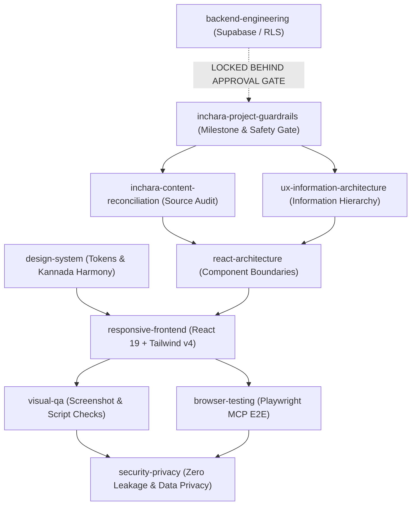

# INCHARA HOLIDAYS — AGENT SKILLS CATALOG
**Version**: 1.0.0  
**Date**: November 9, 2026  
**Scope**: Antigravity AI Engineering Skills Inventory, Capabilities & Governance  

---

## 1. Executive Summary

This catalog documents the complete suite of AI engineering skills configured for the Inchara Holidays project within the Google Antigravity ecosystem. 

These skills provide progressive disclosure runbooks, architectural constraints, design tokens, QA procedures, and safety guardrails tailored to the travel and hospitality domain. They ensure that all pair-programming and autonomous agent operations uphold the heritage-modern brand standards, prevent regressions, and enforce strict milestone boundaries.

---

## 2. Complete Skills Inventory

| Skill Name | Canonical Path | Scope & Applicability | Primary Role |
|---|---|---|---|
| **`inchara-project-guardrails`** | `.agents/skills/inchara-project-guardrails/SKILL.md` | **All Tasks (Global)** | Enforces milestone gates, source-of-truth precedence, change control, and `REPORT.md` updates. |
| **`design-system`** | `.agents/skills/design-system/SKILL.md` | **Frontend UI & Styling** | Canonical color tokens (Forest Evergreen, Mysore Gold, Kasavu Gold, Kaavi Terracotta), typography, Kolam watermarks, and card/button standards. |
| **`ux-information-architecture`** | `.agents/skills/ux-information-architecture/SKILL.md` | **UX & Content Hierarchy** | Structures content across all 6 services, balances depth vs clutter, and guides navigation funnels and the 4-step enquiry wizard. |
| **`inchara-content-reconciliation`** | `.agents/skills/inchara-content-reconciliation/SKILL.md` | **Content Integrity & Auditing** | Compares legacy site data, Figma mocks, and live code to ensure 0% business information loss. |
| **`responsive-frontend`** | `.agents/skills/responsive-frontend/SKILL.md` | **React 19 & Tailwind v4** | Fluid responsive layouts (360px to 1440px), modal stacking (`z-[1050]`), clean props, and bundle performance. |
| **`visual-qa`** | `.agents/skills/visual-qa/SKILL.md` | **Visual QA & Inspection** | Multi-viewport screenshot auditing (360×800, 390×844, 768×1024, 1440×900), bilingual script checks, and defect classification (P0–P3). |
| **`browser-testing`** | `.agents/skills/browser-testing/SKILL.md` | **Automated E2E Testing** | Playwright MCP runbooks for navigation, filter pills, enquiry wizard validation, and state persistence. |
| **`react-architecture`** | `.agents/skills/react-architecture/SKILL.md` | **Frontend Code Architecture** | Component boundaries, state management, TypeScript data models, and separation of presentation from domain data. |
| **`backend-engineering`** | `.agents/skills/backend-engineering/SKILL.md` | **Future Backend (GATED)** | Architecture blueprints for Supabase PostgreSQL, RLS, staff auth, and WhatsApp Cloud API. **STRICTLY GATED until frontend is approved.** |
| **`security-privacy`** | `.agents/skills/security-privacy/SKILL.md` | **Security & Privacy** | Secret hygiene, client/server trust boundaries, spam prevention, and strict DPDP/GDPR prohibition on public passport collection. |
| **`ui-ux-pro-max`** *(Pre-existing)* | `.agents/skills/ui-ux-pro-max/SKILL.md` | **Advanced UI Intelligence** | 79 styles, 192 product palettes, and 119 UX guidelines available locally in `.agents/skills/`. |

---

## 3. Categorization & Applicability Matrix

```
┌────────────────────────────────────────────────────────────────────────┐
│                        SKILLS BY WORKFLOW STAGE                        │
├────────────────────────────────────────────────────────────────────────┤
│ 1. ALL TASKS (Mandatory Baseline)                                      │
│    - inchara-project-guardrails                                        │
│    - security-privacy                                                  │
├────────────────────────────────────────────────────────────────────────┤
│ 2. FRONTEND RECOVERY & IMPLEMENTATION (Current Active Phase)            │
│    - design-system                                                     │
│    - ux-information-architecture                                       │
│    - inchara-content-reconciliation                                    │
│    - responsive-frontend                                               │
│    - react-architecture                                                │
│    - ui-ux-pro-max                                                     │
├────────────────────────────────────────────────────────────────────────┤
│ 3. VERIFICATION & QUALITY ASSURANCE                                    │
│    - visual-qa                                                         │
│    - browser-testing                                                   │
├────────────────────────────────────────────────────────────────────────┤
│ 4. FUTURE BACKEND & DATABASE (Strictly Inactive / Blueprint Only)      │
│    - backend-engineering (Requires explicit owner approval to activate)│
└────────────────────────────────────────────────────────────────────────┘
```

---

## 4. Relationships & Inter-Skill Communication

The skills operate in harmony without contradictory instructions:



---

## 5. Third-Party Ecosystem & Extension Assessment

During ecosystem discovery, the Antigravity Agent Marketplace and local plugin caches were reviewed:

| Candidate Skill / Plugin | Source / Provider | Status | Assessment & Decision |
|---|---|---|---|
| **`Supabase`** (`antigravity-plugins-partners/plugin/supabase`) | Official Marketplace Partner | **Not Installed** | Unnecessary during frontend recovery. Backend activation gate prohibits database integration at this time. Will be evaluated during Milestone 11/12 upon owner instruction. |
| **`Playwright` MCP Server** | Built-in Local MCP (`mcp_playwright`) | **Active & Connected** | Reused directly! Native Playwright browser automation with screenshot, navigation, evaluation, and snapshot tools already powers `browser-testing` and `visual-qa`. No redundant NPM test frameworks needed. |
| **`ui-ux-pro-max`** | Local Workspace (`.agents/skills/ui-ux-pro-max`) | **Preserved & Active** | Pre-existing local skill with comprehensive UI/UX reasoning data. Retained cleanly without collision. |
| **`Semrush` / SEO Plugins** | Marketplace | **Not Installed** | External API dependencies requiring commercial API keys; not justified for baseline local frontend engineering. |
| **Generic Third-Party Claude/Cursor Skills** | External Web | **Rejected** | Do not follow native Antigravity frontmatter or progressive disclosure mechanisms; pose supply-chain risks. Custom project skills created instead. |
